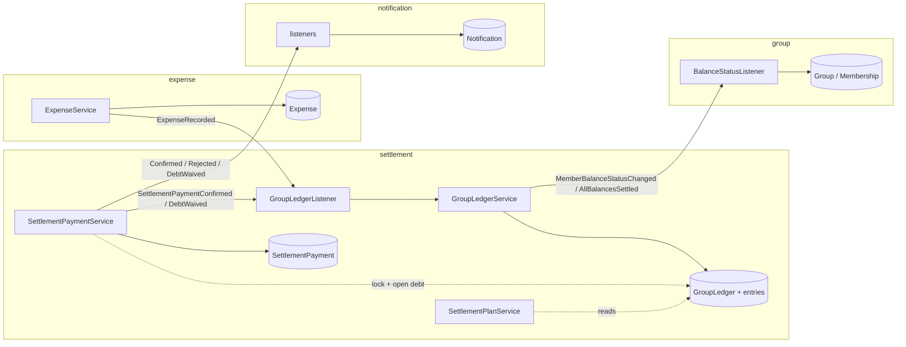
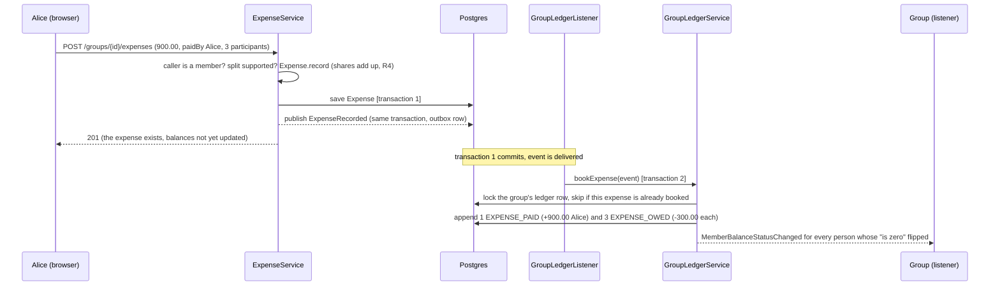
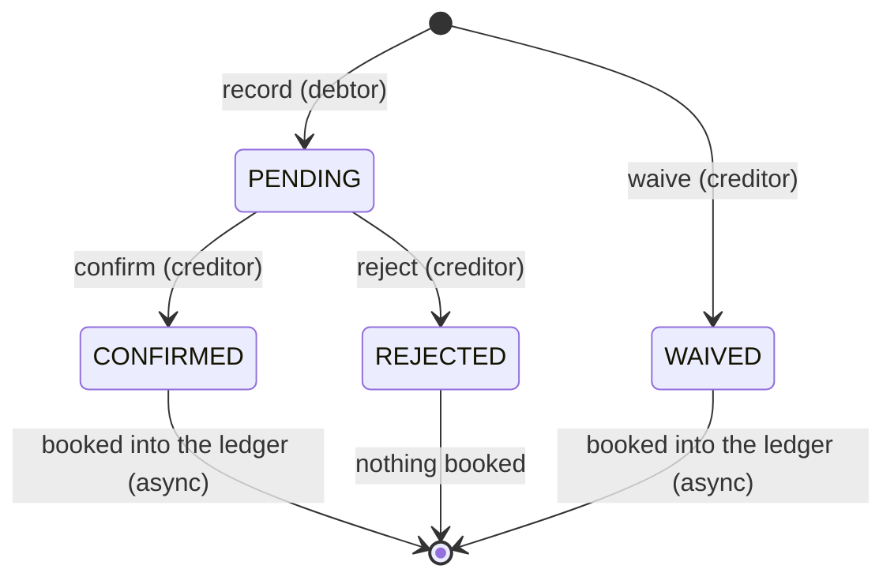
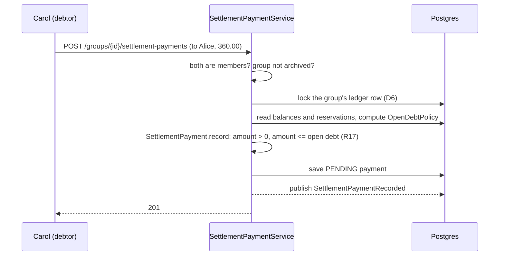

# How money moves in ShareWise: expenses, balances, the plan and settlement payments

**Date:** 04.11.26, sections 12 to 14 added 05.11.26 · **Audience:** the team, for P2 (17.11) and P3 (15.12) · **Status:** describes the code of `feature/settlements` plus the decisions of `2026-11-04-settlements-inbox-design.md` (marked *new*) · **Numbers** in sections 4 to 8 are computed by a script (integer cents), not by hand.

This is the core of the application. If a statement here and the code disagree, one of them is a defect.

## 1. The model in five sentences
1. **The ledger is the only truth about who owes whom.** It is a list of entries that is only ever appended to (R14); a person's **balance** is the sum of their entries, and the balances of a group always add up to 0.
2. **An expense** books entries: the payer is credited the total, every participant is debited their share.
3. **The settlement plan is never stored.** It is computed from the balances each time it is asked for: the fewest transfers that bring everybody to 0 (R15).
4. **A settlement payment is a request, not a fact.** The debtor reports "I paid Alice 50.00"; it is PENDING and the ledger does not change. Only when the creditor confirms (R16) is it booked. A reject books nothing.
5. **A waiver is the creditor forgiving a debt.** It needs no confirmation (the creditor is the one who loses) and is booked at once.

The consequence that surprises people: *a payment can change the plan only after it is booked*. Between report and answer it only **reserves** part of the debtor's debt, so the same debt cannot be reported twice.

## 2. Words
| Word | Meaning | Where |
|---|---|---|
| **Expense** | something one person paid for the group, split between participants (today only EQUAL, R4) | `expense` module |
| **Share** (`ExpenseShare`) | what one participant owes for one expense | event `ExpenseRecorded` |
| **Ledger entry** | one signed amount for one person, with a type and a reference (the expense or payment id) | `settlement.domain.LedgerEntry` |
| **Balance** | sum of a person's entries. Positive: the group owes them. Negative: they owe the group | query `GroupLedgerRepository.totals` |
| **Plan** (`SettlementPlan`) | list of edges "X pays Y amount", computed from balances | `settlement.domain.SettlementPlan` |
| **Settlement payment** | a reported transfer between two people, with a status | `settlement.domain.SettlementPayment` |
| **Reservation** | the amount of a payment that is PENDING (or confirmed but not yet booked) and so is already spoken for | query `SettlementPaymentRepository.reserved` |
| **Open debt** | how much X may still pay (or Y waive) in the pair X to Y right now | `OpenDebtPolicy` |
| **Payable** *(new)* | the open debt of a plan edge, shown on the screen so the button matches what the server accepts | contract field `payableAmount` |

Statuses of a payment: `PENDING` (reported), `CONFIRMED`, `REJECTED`, `WAIVED` (a waiver is created already in this state).

## 3. Who talks to whom

Solid arrows with a label are **events** (asynchronous, after the commit, kept in the event publication registry, so a crash does not lose them; consumers are idempotent). Dotted arrows are synchronous reads inside one module. `settlement` also asks `group` synchronously (is the caller a member? is the group open?) through the port `GroupMembership`. The arrows into `notification` are *new*.

## 4. Flow 1: recording an expense
Example: Alice, Bob and Carol are in "Mallorca". Alice pays the hotel, 900.00, split equally between all three. Then Bob pays the dinner, 180.00, split equally.


- **Equal split with a remainder (R4):** 100.00 between three is 33.34, 33.33, 33.33. The remainder cents go to the first participants, so the shares always add up exactly.
- **Entries of the two expenses** (the payer's credit and every share are separate entries):

| After | Alice | Bob | Carol | Sum |
|---|---|---|---|---|
| hotel 900.00 paid by Alice | +600.00 | −300.00 | −300.00 | 0.00 |
| dinner 180.00 paid by Bob | **+540.00** | **−180.00** | **−360.00** | 0.00 |

- **Eventual consistency:** the `201` comes before the ledger is updated. For a moment the balances page does not show the new expense. That is why the frontend re-fetches and why integration tests use Awaitility instead of sleeping.
- **Idempotency:** the ledger row is locked, and `isBooked(group, expenseId)` makes a redelivered event book nothing (the unique constraint on reference, person and entry type is the last line of defence).

## 5. Flow 2: the settlement plan
`GET /groups/{id}/settlement-plan` loads the balances (one query) and runs `SettlementPlan.of`:
- only people with a non-zero balance take part;
- **up to 16 such people:** exact minimum (R15). The people are split into the largest possible number *k* of disjoint zero-sum sets (sets of people whose balances add up to zero; bitmask dynamic programming over subsets). A zero-sum set of *m* people settles among itself with *m − 1* transfers, so the total is *n − k*, the minimum;
- **above 16:** one greedy pass over everyone (largest debtor pays largest creditor), at most *n − 1* transfers, not guaranteed minimal (our choice, not from the slides; nothing tells the caller).
- ties are broken by user id, so the same balances always give the same plan.

*How the search runs, step by step, on an example with three payers: section 13. Why the limit is 16 and which other algorithms exist: section 14.*

Example, after the two expenses: Alice +540.00, Bob −180.00, Carol −360.00. Plan: **Bob pays Alice 180.00, Carol pays Alice 360.00** (two transfers, the minimum for three people with one creditor).

The plan is a *view*. Nothing is stored, so it can never be stale in the database; it is as current as the last booked entry. When a new entry is booked, the plan can change shape completely (edges appear, disappear, change partner). That is correct, because it is recomputed from the new balances.

## 6. Flow 3: a settlement payment
### 6.1 States

`record` and `waive` are *factories*: they create the payment (diagram delta S1). Only the creditor can answer (`NOT_THE_CREDITOR`), and only once (`PAYMENT_NOT_PENDING`).

### 6.2 Record: reserve, do not book

Nothing in the ledger changed. What stops a second report of the same debt is the **reservation** (below): the second request sees the first one's PENDING row and is refused, also when it comes from a second tab or device with an old screen. The lock makes the check and the insert one step: it covers the case where two requests arrive within milliseconds, and it also keeps `record` and the booking of an expense or a confirmed payment from running at the same time (both take the same ledger row). It is per group, not per debtor.

**Open debt** of the pair *debtor X → creditor Y* is the smaller of two numbers, never below 0 *(changed 09.11.26: the plan edge is no longer a cap, see the end of this section)*:

| Cap | Formula | Why |
|---|---|---|
| the debtor's debt | −balance(X) − reserved by X to anyone | X cannot pay more than X owes in total |
| the creditor's credit | balance(Y) − reserved to Y by anyone | Y cannot be paid more than Y is owed |

Example: Carol owes 360.00 (plan edge 360.00). Before her report: open debt 360.00. After her PENDING report of 360.00: **0.00**, a second report is refused with 422 `PAYMENT_EXCEEDS_OPEN_DEBT`. That is the whole point of the reservation. What counts as reserved: PENDING payments, plus CONFIRMED or WAIVED payments the ledger has not booked yet (so the gap between "confirmed" and "booked" cannot be used to spend the debt twice, decision D5).

**Why the plan is not a cap (changed 09.11.26).** The first design also capped the open debt by the plan edge of the pair, so a payment to someone the plan does not pair you with was refused (design 02.11.26, decision "option B"). We dropped that. Balances are pooled: "Carol owes Alice" is not stored anywhere, it is what the plan suggests, and the plan depends on tie-breaking by user id and on the limit of 16 people. A payment is a fact (a transfer that happened, as in section 8), so the server accepts it up to what the debtor owes and the creditor is owed. The screen still follows the plan: it offers "I paid" only on plan edges, with `payableAmount` = the edge minus what is reserved on the pair, but never more than the open debt. Example: Alice +50.00, Bob +40.00, Carol −60.00, David −30.00; the plan has Carol→Alice 50.00, Carol→Bob 10.00, David→Bob 30.00. David could pay Alice 30.00 outside the plan and the server records it (open debt 30.00); the screen offers Carol→Bob only 10.00 although the server would take up to 40.00. This also means `record` and `waive` no longer run the plan search.

### 6.3 Confirm, reject, waive
- **Confirm** (creditor): `SettlementPayment.confirm` sets CONFIRMED and returns `SettlementPaymentConfirmed`; the service saves and publishes. A listener in `settlement` calls `bookSettlementPayment`, which appends `PAYMENT_SENT` (debtor +amount) and `PAYMENT_RECEIVED` (creditor −amount), both referencing the payment id (so a redelivery books once). *Confirm does not check the open debt again (decision of 04.11.26, section 8).*
- **Reject** (creditor): sets REJECTED, publishes `SettlementPaymentRejected`, books nothing. The reservation ends because the status is no longer PENDING.
- **Waive** (creditor): same checks as record (open debt, lock), but the payment is created WAIVED and `DebtWaived` is published; the ledger books `DEBT_WAIVED` on both sides. A reason is required.
- **Two answers at once** (two tabs): `@Version` on the payment makes the second fail with a conflict instead of both succeeding.

### 6.4 The numbers, step by step (Carol pays Alice, Alice waives for Bob)
| Step | Alice | Bob | Carol | Sum |
|---|---|---|---|---|
| after both expenses | +540.00 | −180.00 | −360.00 | 0.00 |
| Carol reports 360.00 (PENDING) | +540.00 | −180.00 | −360.00 | 0.00 |
| Alice confirms; the listener books | +180.00 | −180.00 | **0.00** | 0.00 |
| Alice waives 90.00 of Bob's debt | +90.00 | −90.00 | 0.00 | 0.00 |

## 7. What is immediate and what is eventual
| Thing | When it is current |
|---|---|
| The payment's status, the reservation, "waiting for my answer" | immediately (same transaction, a query) |
| The ledger, balances, the plan | moments after the event (asynchronous booking) |
| `Membership.hasZeroBalance` (needed to leave a group, R11) | after the balance event; an older event never overwrites a newer one (`balanceStatusAt`, D12) |
| The payer's inbox entry "confirmed / rejected / waived" *(new)* | moments after the event |

## 8. The R17 decision: what "open debt" does and does not promise
R17 says a payment or waiver may not exceed the open debt. We check it **when the payment is reported and when a debt is waived**, under the ledger lock. We do **not** check it again at confirm.

*Why:* the creditor's confirmation says "the money arrived". That is a fact about the real world, and the ledger must record facts. Example: Bob owes Alice 50.00, hands her 50.00 in cash and reports it. Before Alice answers, Carol pays an expense of 50.00 that only Alice owes. Booking Bob's cash then gives Alice −50.00, Bob 0.00, Carol +50.00: Alice now owes Carol 50.00, which is exactly the truth. Refusing the confirm would force Alice to reject money she really received.

*What follows:* "no balance crosses zero" is **not** a ledger invariant. Expenses move balances across zero at any time and are never checked. R17 protects against *typing a bigger amount than you owe or double-reporting one debt*, and nothing more. (The first handover, finding A1, proposed a re-check at confirm; the independent design review of 04.11.26 showed it records a falsehood and was withdrawn.)

## 9. The plan edge that cannot be paid *(new, A3)*
After a reshuffle the plan can show an edge on which nothing can be paid. Example: Alice +50.00, Bob −50.00. Bob reports 50.00 to Alice (PENDING, reserved). Carol pays an expense of 50.00 that only Alice owes: Alice 0.00, Bob −50.00, Carol +50.00. The plan is now **Bob pays Carol 50.00**, but Bob's whole debt is reserved by the payment to Alice, so his open debt to Carol is 0.00.

| Edge field | Value | Meaning |
|---|---|---|
| `amount` | 50.00 | what the plan says |
| `pendingAmount` | 0.00 | reserved on this pair (Bob to Carol): none |
| `payableAmount` *(new)* | **0.00** | what the screen offers now (never more than the server accepts); the "I paid" button is shown only when it is above 0 |

Once Alice answers, the picture clears: confirmed gives Alice −50.00, Bob 0.00, Carol +50.00 (plan: Alice pays Carol 50.00); rejected frees the reservation and Bob can pay Carol. `payableAmount` is computed by the same `OpenDebtPolicy` as the open debt `record` uses, and then limited to the plan edge, so the screen never offers more than the server accepts.

## 10. Where each rule lives (so it is checked once)
| Rule | Enforced in | Tested in |
|---|---|---|
| R4 shares add up, remainder to the first | `EqualSplit`, `Expense.record` | `ExpenseTest`, `EqualSplitTest` |
| R14 ledger entries per expense/payment | `GroupLedger.append*` | `GroupLedgerTest` |
| R15 fewest transfers | `SettlementPlan` | `SettlementPlanTest` (the A+3, B+3, C−6, D+5, E−5 case separates exact from greedy) |
| R16 payment counts only after confirm | `SettlementPayment` states + booking only in the listener | `SettlementPaymentTest`, `MallorcaSliceTest` |
| R17 amount ≤ open debt, no double report | `SettlementPayment.record/waive` with the value from `OpenDebtPolicy`, under the ledger lock | domain unit test; `SettlementPaymentServiceDbTest.twoConcurrentRecordsOfTheSameDebtorCannotTogetherExceedTheDebt` |
| Idempotent booking | `isBooked` + unique constraint on (reference, person, entry type) | `GroupLedgerServiceTest` |
| One answer per payment | `@Version`, status check | `SettlementPaymentTest`, API test |

## 11. Limits we know and accept
- Plan above 16 people is greedy and says nothing (the limit is more careful than it needs to be and the alternatives are weighed in section 14).
- An equal split with a remainder always gives the extra cents to the first participants in the order given (section 12).
- The reject reason replaces the debtor's note (one `note` field).
- A rejected or ignored PENDING payment keeps its reservation until the creditor answers; there is no timeout (parked, trigger: users complain).
- Currency is EUR only in the settlement context.

## 12. Splitting money exactly: R4, cents, BigDecimal and the alternatives
*Added 05.11.26. Nothing here changes the code; it records what we do, why, and what else we could do. Which choice is ours and which comes from the slides is stated per row. The professor's slides say nothing about how to round a split.*

### 12.1 What happens now
`EqualSplit.split` (`expense.domain`) works in whole cents: `base = total / n` (integer division), `remainder = total % n`, and the first `remainder` participants, in the order the request gave, get one cent more. The shares therefore **always add up to the total** (no cent is lost or invented), but they are **not always equal**.

| Total | People | Shares (in the order given) | Check |
|---|---|---|---|
| 100.00 | 3 | 33.34, 33.33, 33.33 | 100.00 |
| 10.00 | 3 | 3.34, 3.33, 3.33 | 10.00 |
| 900.00 | 3 | 300.00, 300.00, 300.00 | 900.00 (no remainder, all equal) |

"Exact" can mean two things. *The shares sum exactly to the total*: met, always. *Everybody pays exactly the same*: impossible in whole cents whenever the total is not divisible by the number of people (1000 cents / 3 = 333.33... cents). Any rule has to put the leftover cents on somebody; the only choice is who.

### 12.2 Who gets the leftover cents: the options
| Option | Rule | For | Against |
|---|---|---|---|
| **A. First participants (today, our call)** | the order given in the request | simplest; deterministic; one line of integer arithmetic; easy to test (`remainderCentsGoToFirstParticipants`) | the same person gets the extra cent on every expense if the form always lists people in the same order. Harmless in size (at most n − 1 cents per expense) but not even |
| **B. Rotate by expense** | e.g. start at index `hash(expenseId) mod n` | evens out over many expenses; still deterministic for one expense | the order stops being readable ("why did Carol pay more?"); a hash rule has to be explained and tested |
| **C. The payer absorbs it** | everybody else gets `base`, the payer gets `base + remainder` | the person who is paid back loses the cents, nobody who owes is surprised | a group where one person pays everything always loses cents; special case in the rule (payer may not be a participant) |
| **D. Random** | pick who gets the cents | fair on average | not repeatable, so tests, support and audits cannot reproduce a share. Rejected |
| **E. Track a "cent debt" per person** | remember who got extra cents before | perfectly fair over time | a new piece of state and a new rule for a few cents. Violates "keep it simple" (conventions 03, section 7) |

Cost if A turns out to be wrong: a one-method change in `EqualSplit` plus its test; stored expenses keep their shares, because the shares are stored, not recomputed (`expense_shares`). That is why A is cheap to keep for now.

### 12.3 Cents or BigDecimal?
Both, at different layers, and the boundary is `Money`:

| Layer | Representation | Why |
|---|---|---|
| API (JSON) | decimal **string** with two digits, `"100.00"` | a JSON number becomes a binary float in JavaScript |
| Database | `NUMERIC(19,2)` | exact decimal, constraints in the database |
| `Money` (shared) | `BigDecimal` with the currency's scale (EUR: 2) plus `Currency` | the diagram draws `Money` this way (decision R2 of the diagram alignment); equal amounts are equal records because the scale is fixed |
| **Inside** `EqualSplit` and `SettlementPlan` | `long` cents, taken with `minorUnits()` and returned with `Money.ofMinorUnits` | see below |

Why `long` inside the two algorithms:
- **`EqualSplit`** needs "divide and keep the remainder". With `long`, `/` and `%` say exactly that and cannot round. With `BigDecimal`, `divide` needs a rounding mode, and a wrong mode invents or loses a cent; `divideAndRemainder` would work but is no clearer.
- **`SettlementPlan`** compares sums to exactly 0 on up to 2^16 subsets, adds and subtracts in a tight loop and stores them in a `long[]`. Plain `long` is exact, needs no object per sum (not measured, but it is the obvious difference), and `==` 0 cannot trip over scale (`0` versus `0.00` is a classic `BigDecimal.equals` trap).
- The conversion is exact in both directions: `Money` always has the currency's scale, so `unscaledValue()` is the cent count (`longValueExact` throws if it ever did not fit).

Alternatives that were weighed:
| Alternative | Verdict |
|---|---|
| `double`/`float` everywhere | never: 0.1 + 0.2 is not 0.3. Forbidden by the conventions |
| `long` cents everywhere (our Ex4 design, D8) | simplest and fastest, but the diagram says `BigDecimal` and the database/JSON would need `_cents` names; changed on 27.10 for that reason |
| `BigDecimal` everywhere including the plan algorithm | possible; slower and noisier for no gain in correctness, since the algorithm never rounds |
| A money library (JavaMoney, Joda-Money) | more than a study project needs; our `Money` has the five operations we use |

## 13. The plan algorithm, step by step, on an example with three payers
*All numbers were computed by a script (a Python replica of `SettlementPlan`, integer cents) on 05.11.26; the script lives in the scratch folder, not in the repository. People are called by their first letter; in the real code they are ordered by ascending `UserId`, here A < B < C < D < E.*

### 13.1 The trip
Five people, three of them pay something. Alice and Carol share a room, Bob and Carol share a boat trip, David and Eva share a dinner:

| Expense | Paid by | Total | Split EQUAL between | Shares |
|---|---|---|---|---|
| Room | Alice | 60.00 | Alice, Carol | 30.00 / 30.00 |
| Boat trip | Bob | 60.00 | Bob, Carol | 30.00 / 30.00 |
| Dinner | David | 100.00 | David, Eva | 50.00 / 50.00 |

Balances (paid − owed, section 4): **Alice +30.00, Bob +30.00, Carol −60.00, David +50.00, Eva −50.00**; sum 0.00. Everyone has a non-zero balance, so n = 5. In cents: +3000, +3000, −6000, +5000, −5000.

Look at the shape: Alice, Bob and Carol only ever dealt with each other (30 + 30 − 60 = 0), and so did David and Eva (50 − 50 = 0). A fair plan should never ask Carol to pay David. That is exactly what the search discovers.

### 13.2 What the search looks for
*Idea.* A set of people whose balances add up to 0 can settle among themselves. If the people can be cut into *k* such sets, a set of *m* people needs *m − 1* transfers (each transfer clears at least one person, and the last one clears two). The total is **n − k**, so the fewest transfers = the **most** zero-sum sets. Here the zero-sum sets are {A,B,C} (3000 + 3000 − 6000), {D,E} (5000 − 5000) and everybody. Best cut: k = 2, transfers = 5 − 2 = **3**.

Finding the best cut is a search over subsets: with n people there are 2^n subsets to look at. The code does it as a **dynamic programme over bitmasks**: bit *i* of a number means "person *i* is in the set". Mask `00111` is {A,B,C}; `11000` is {D,E}; `11111` is everybody.

For every mask, in increasing order, it stores three things:
- `sum[mask]`: the balances of the set added up. Cheap: take the sum of the mask without its lowest person and add that person (`sum[mask & (mask-1)] + cents[low]`).
- `best[mask]`: the **largest number of zero-sum prefixes** that any ordering of the people in this mask can have. Think of lining the people up and adding their balances left to right; every time the running sum hits 0, a set is complete.
- `choice[mask]`: which person stands **last** in that best ordering.

The rule: try every person *i* in the mask as the last one; the best you can do is `best[mask without i]`, plus 1 if the whole mask sums to 0. Take the *i* with the highest value (ties: the lowest index).

### 13.3 The table for our five people
Bits are written E D C B A (A is the rightmost). Rows where `best` is 1 or more are the interesting ones; the full 31-row table is below it.

| mask | set | sum | best | last | Reading |
|---|---|---|---|---|---|
| `00111` | {A,B,C} | 0 | 1 | A | first zero-sum set: one set complete |
| `11000` | {D,E} | 0 | 1 | D | second zero-sum set |
| `11100` | {C,D,E} | −6000 | 1 | C | contains {D,E} as a complete prefix, C is left over |
| `11111` | everyone | 0 | **2** | A | order E, D, C, B, A has two zero prefixes: so k = 2 |

<details><summary>All 31 masks</summary>

```
mask  set            sum   best last      mask  set            sum   best last
00001 {A}            3000  0    A         10001 {A,E}         -2000  0    A
00010 {B}            3000  0    B         10010 {B,E}         -2000  0    B
00011 {A,B}          6000  0    A         10011 {A,B,E}        1000  0    A
00100 {C}           -6000  0    C         10100 {C,E}        -11000  0    C
00101 {A,C}         -3000  0    A         10101 {A,C,E}       -8000  0    A
00110 {B,C}         -3000  0    B         10110 {B,C,E}       -8000  0    B
00111 {A,B,C}           0  1    A         10111 {A,B,C,E}     -5000  1    E
01000 {D}            5000  0    D         11000 {D,E}            0  1    D
01001 {A,D}          8000  0    A         11001 {A,D,E}       3000  1    A
01010 {B,D}          8000  0    B         11010 {B,D,E}       3000  1    B
01011 {A,B,D}       11000  0    A         11011 {A,B,D,E}     6000  1    A
01100 {C,D}         -1000  0    C         11100 {C,D,E}      -6000  1    C
01101 {A,C,D}        2000  0    A         11101 {A,C,D,E}    -3000  1    A
01110 {B,C,D}        2000  0    B         11110 {B,C,D,E}    -3000  1    B
01111 {A,B,C,D}      5000  1    D         11111 {A,B,C,D,E}      0  2    A
```
</details>

### 13.4 Reading the sets back
Start at the full mask and repeatedly remove the stored `last` person. Whenever the remaining set sums to 0 (and a set is under way), that set is closed:

| Step | Remaining set | its sum | person taken out (`last`) | Action |
|---|---|---|---|---|
| 1 | {A,B,C,D,E} | 0 | A | the current set is empty, so nothing to close; A goes into it |
| 2 | {B,C,D,E} | −3000 | B | B joins |
| 3 | {C,D,E} | −6000 | C | C joins |
| 4 | {D,E} | **0** | D | sum is 0 and the current set has people: **close set 1 = {A,B,C}**; D starts set 2 |
| 5 | {E} | −5000 | E | E joins; the end closes set 2 = {D,E} |

Result: sets {A,B,C} and {D,E}, k = 2.

### 13.5 Settling each set greedily
Inside a set the **largest debtor pays the largest creditor** as much as both can bear, and repeat; ties go to the lower user id. A set of *m* people ends after at most *m − 1* transfers.

| Set | Step | Transfer | Balances after |
|---|---|---|---|
| {A,B,C} | 1 | Carol pays Alice 30.00 (tie Alice/Bob: Alice has the lower id) | A 0, B +30, C −30 |
| {A,B,C} | 2 | Carol pays Bob 30.00 | all 0 |
| {D,E} | 1 | Eva pays David 50.00 | all 0 |

**The plan: Carol → Alice 30.00, Carol → Bob 30.00, Eva → David 50.00. Three transfers = 5 − 2.** The edges are listed by creditor, then debtor id (`SettlementPlan.of`, last lines).

### 13.6 The same balances with plain greedy (what we use above 16 people)
One pass over all five, largest debtor to largest creditor:

| Step | Transfer | Balances after (A, B, C, D, E) |
|---|---|---|
| 1 | Carol pays David 50.00 | +30, +30, −10, 0, −50 |
| 2 | Eva pays Alice 30.00 | 0, +30, −10, 0, −20 |
| 3 | Eva pays Bob 20.00 | 0, +10, −10, 0, 0 |
| 4 | Carol pays Bob 10.00 | 0, 0, 0, 0, 0 |

**Four transfers instead of three**, and worse for people: Carol is asked to pay David, with whom she never shared anything, and Eva pays two people she does not know. Greedy is correct (everybody ends at 0), just not minimal. This is the test case "A+3, B+3, C−6, D+5, E−5" in section 10.

### 13.7 Why the exact search is worth having, and when it is not
- Exact and greedy differ **only when a proper subset of people adds up to exactly zero**. If the balances contain no such subset, then k = 1 and both need n − 1 transfers.
- Measured on random balances (50 groups per size; scratch script, 05.11.26): with balances in ±0.30 (units of 0.01, so zero-sum subsets are common) greedy needed more transfers in 2 of 50 groups at n = 6, 26 of 50 at n = 10 and 34 of 50 at n = 12. With balances in ±1000.00 greedy was **never** worse in any size up to 12, because random large balances almost never contain a zero-sum subset.
- In the app, zero-sum subsets come from people who share expenses only among themselves, as in 13.1 (two couples, a room, a dinner for two). **How often that happens in real groups is unknown**; the random numbers above are an extreme to show the mechanism, not a prediction.

## 14. Search algorithms for the plan: options and trade-offs
*Added 05.11.26. The choice of algorithm and of the limit 16 is ours, not from the slides. Nothing below is implemented except what is marked "today".*

### 14.1 The problem
Given the balances b₁ … bₙ (non-zero, sum 0), find the plan with the **fewest transfers**. All plans move the same total (the sum of the positive balances), so the number of transfers is the only thing to minimise. As shown in 13.2 this means: **partition the people into the maximum number k of zero-sum sets** (transfers = n − k).

This is a genuine search problem and it is hard. The question "is k at least 2?" asks whether some proper subset of the balances adds up to exactly 0, which is the (NP-complete) subset-sum problem. So no fast exact algorithm is known for large n, and we should not expect to find one. (This follows from our own reduction in one line; we did not look up a reference.) The real choices are therefore: exact and exponential, or fast and approximate.

### 14.2 The candidates
| # | Algorithm | Exact? | Time | Memory | Notes |
|---|---|---|---|---|---|
| 1 | **Bitmask DP over subsets (today, n ≤ 16)** | yes | O(2^n · n) | 16 bytes · 2^n | simple, predictable: cost depends on n only, not on the values. Section 13 |
| 2 | **Plain greedy (today, n > 16)** | no | O(n²) | O(n) | at most n − 1 transfers; never more than twice the minimum (see below) |
| 3 | **Backtracking search** (the usual "optimal account balancing" solution): take the first person with a balance, try settling them against every opposite-sign person, recurse; skip equal balances already tried; an exact pair ends the loop | yes | worst case factorial in n | O(n) | tried, see 14.3 |
| 4 | **Cancel exact pairs first, then #1 or #2** | as exact as the algorithm behind it; never worse than #2 alone | O(n log n) + the rest | O(n) | a person with +x and one with −x can always settle together (swapping argument: an optimal cut can be rearranged to contain that pair), so this step is safe and removes people from the expensive part. Not built |
| 5 | **Extract small zero-sum sets (pairs, triples) first, greedy for the rest** | no | O(n³) for triples | O(n) | polynomial; captures the common real case (two couples, a trio) but can miss larger groups. Not built |
| 6 | **Meet in the middle** for finding zero-sum subsets: split people in two halves, list the 2^(n/2) sums of each, match them | finds one subset | O(2^(n/2) · n) | 2^(n/2) | takes the square root of the cost of #1 for *finding* a subset; choosing the *best set of disjoint* subsets needs more machinery on top. Not built, so no claim about total gain |
| 7 | **Integer programming / constraint solver** (variables "person *i* is in set *g*", maximise non-empty zero-sum sets) | yes | solver dependent | solver | handles dozens of people; a heavy dependency for a study project. Not built |
| 8 | **Do not simplify** (pairwise netting only: for each pair, the net of what they owe each other) | no | O(n²) | O(n) | far more transfers, but every transfer is between two people who really shared expenses; the plan changes less when a new expense arrives. Contradicts R15 (fewest payments) |

*A fact worth knowing for the defence:* every zero-sum set has at least two people, so k ≤ n / 2 and the minimum n − k is at least n / 2. Greedy needs at most n − 1, so **greedy is never worse than twice the minimum**. That makes the fallback above the limit a safe "good enough" and not a trap.

### 14.3 What we measured
Scratch script, Java 21 on the development laptop, one run per cell, JVM not warmed up, so read the order of magnitude, not the digits. Balances random; the node limit of the backtracking was 5 million.

| People | Bitmask DP (#1) time | memory (16 B · 2^n) | Backtracking (#3) |
|---|---|---|---|
| 12 | under 1 ms | under 1 MB | 2 to 5 ms, finished (86 000 to 162 000 nodes) |
| 16 | 2 to 3 ms | 1 MB | **gave up** at 5 million nodes (about 0.2 s) |
| 18 | 12 to 14 ms | 4 MB | gave up |
| 20 | 48 to 52 ms | 16 MB | gave up |
| 22 | 200 to 230 ms | 67 MB | gave up |
| 24 | not run | about 268 MB (computed, not measured) | gave up |
| 26 | not run | about 1 GB (computed, not measured) | not run |

What this says:
1. **The DP is predictable and the limit 16 is much more careful than it needs to be.** At n = 16 it takes a few milliseconds and 1 MB. Doubling the cost per added person is still comfortable up to about 20 (about 50 ms, 16 MB) on this machine. Memory, not time, is what ends it: from 24 people on a single request would allocate hundreds of megabytes.
2. **The simple backtracking does not beat the DP.** It agreed with the DP on every instance where it finished (all 50 per size up to 12 people, both balance ranges), but it needs more work than the DP already at 12 people and gives up at 16 where the DP needs 3 ms. It has the opposite weakness: cost depends on the values, so a bad group can stall a request, and it uses almost no memory. Smarter pruning exists; we did not try it.
3. **A request that computes the plan must stay fast and bounded**, because the plan is recomputed on every `GET`. The DP's cost is known from n alone, which is the property we want for a cap.

### 14.4 How we would decide if the limit ever hurts
This is not decided. It is the order we would try things, cheapest first:

1. **Raise the limit** from 16 to about 20 in `SettlementPlan.EXACT_LIMIT`. One constant, one test (`SettlementPlanTest` uses "more than 16" people for the fallback case, so it changes together). Cost per request at most about 50 ms and 16 MB.
2. **Cancel exact opposite pairs before the search** (#4): cheap and safe, and it shrinks n before the exponential part, so a 30-person group with many exact pairs would still get an exact plan.
3. **Pairs and triples first, greedy for the rest** (#5) as a better fallback than plain greedy above the limit.
4. Only if real groups of 25 or more people with tangled balances exist: a solver (#7) or a real study of the problem. Today a group with more than 16 non-zero people is rare, and the fallback is within a factor 2.

**What we do not do:** change the plan to something people might find easier to read (#8) without asking, because R15 says fewest payments and that choice changes what users see.

### 14.5 What each choice costs if it is wrong
| Choice | If wrong | Fix |
|---|---|---|
| Limit 16 too low | a 17th active debtor gets a plan with up to a few extra transfers; nothing is incorrect | change one constant |
| Limit raised too high | one slow, memory-hungry `GET` can hurt the server | lower the constant; consider a timeout |
| Greedy fallback silent | users do not know the plan may not be minimal | show a hint in the UI or the response (a contract change, ask first) |
| First participants get the cents (section 12) | one person pays a few cents more over many expenses | rule B or C of section 12.2, a change in `EqualSplit` only |
