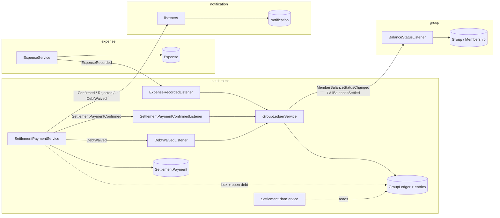
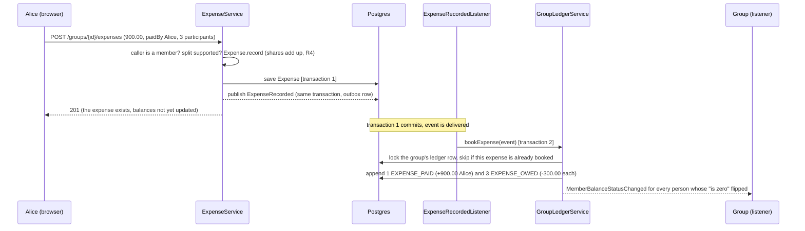
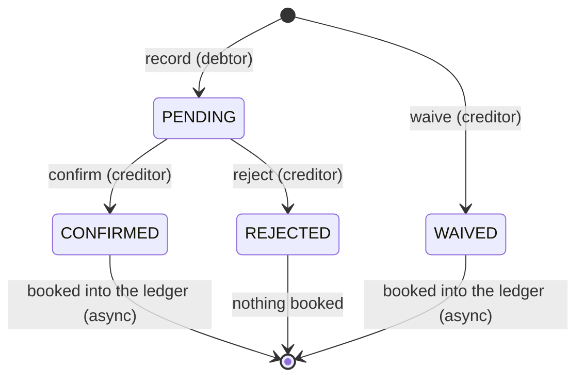
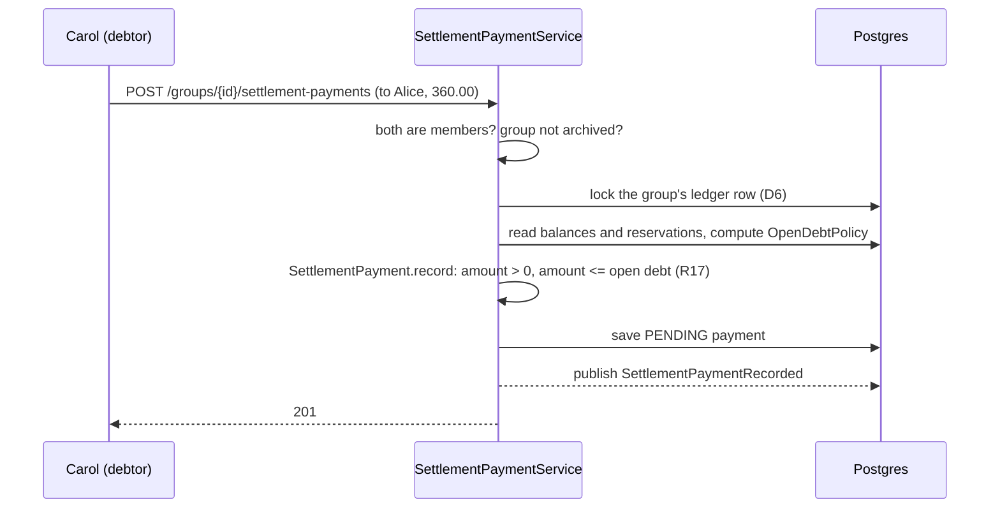

# How money moves in ShareWise: expenses, balances, the plan and settlement payments

**Date:** 04.11.26 · **Audience:** the team, for P2 (17.11) and P3 (15.12) · **Status:** describes the code of `feature/settlements` plus the decisions of `2026-11-04-settlements-inbox-design.md` (marked *new*) · **Numbers** in sections 4 to 8 are computed by a script (integer cents), not by hand.

This is the core of the application. If a statement here and the code disagree, one of them is a defect.

## 1. The model in five sentences
1. **The ledger is the only truth about who owes whom.** It is a list of entries that is only ever appended to (R14); a person's **balance** is the sum of their entries, and the balances of a group always add up to 0.
2. **An expense** books entries: the payer is credited the total, every participant is debited their share.
3. **The settlement plan is never stored.** It is computed from the balances each time it is asked for: the fewest transfers that bring everybody to 0 (R15).
4. **A settlement payment is a request, not a fact.** The debtor reports "I paid Alice 50.00"; it is PENDING and the ledger does not change. Only when the creditor confirms (R16) is it booked. A reject books nothing.
5. **A waiver is the creditor forgiving a debt.** It needs no confirmation (the creditor is the one who loses) and is booked at once.

The consequence that surprises people: *a payment can change the plan only after it is booked*. Between report and answer it only **reserves** part of the debtor's debt, so the same debt cannot be reported twice.

## 2. Words
| Word | Meaning | Where |
|---|---|---|
| **Expense** | something one person paid for the group, split between participants (today only EQUAL, R4) | `expense` module |
| **Share** (`ExpenseShare`) | what one participant owes for one expense | event `ExpenseRecorded` |
| **Ledger entry** | one signed amount for one person, with a type and a reference (the expense or payment id) | `settlement.domain.LedgerEntry` |
| **Balance** | sum of a person's entries. Positive: the group owes them. Negative: they owe the group | query `GroupLedgerRepository.totals` |
| **Plan** (`SettlementPlan`) | list of edges "X pays Y amount", computed from balances | `settlement.domain.SettlementPlan` |
| **Settlement payment** | a reported transfer between two people, with a status | `settlement.domain.SettlementPayment` |
| **Reservation** | the amount of a payment that is PENDING (or confirmed but not yet booked) and so is already spoken for | query `SettlementPaymentRepository.reserved` |
| **Open debt** | how much X may still pay (or Y waive) in the pair X to Y right now | `OpenDebtPolicy` |
| **Payable** *(new)* | the open debt of a plan edge, shown on the screen so the button matches what the server accepts | contract field `payableAmount` |

Statuses of a payment: `PENDING` (reported), `CONFIRMED`, `REJECTED`, `WAIVED` (a waiver is created already in this state).

## 3. Who talks to whom

Solid arrows with a label are **events** (asynchronous, after the commit, kept in the event publication registry, so a crash does not lose them; consumers are idempotent). Dotted arrows are synchronous reads inside one module. `settlement` also asks `group` synchronously (is the caller a member? is the group open?) through the port `GroupMembership`. The arrows into `notification` are *new*.

## 4. Flow 1: recording an expense
Example: Alice, Bob and Carol are in "Mallorca". Alice pays the hotel, 900.00, split equally between all three. Then Bob pays the dinner, 180.00, split equally.

- **Equal split with a remainder (R4):** 100.00 between three is 33.34, 33.33, 33.33. The remainder cents go to the first participants, so the shares always add up exactly.
- **Entries of the two expenses** (the payer's credit and every share are separate entries):

| After | Alice | Bob | Carol | Sum |
|---|---|---|---|---|
| hotel 900.00 paid by Alice | +600.00 | −300.00 | −300.00 | 0.00 |
| dinner 180.00 paid by Bob | **+540.00** | **−180.00** | **−360.00** | 0.00 |

- **Eventual consistency:** the `201` comes before the ledger is updated. For a moment the balances page does not show the new expense. That is why the frontend re-fetches and why integration tests use Awaitility instead of sleeping.
- **Idempotency:** the ledger row is locked, and `isBooked(group, expenseId)` makes a redelivered event book nothing (the unique constraint on reference, person and entry type is the last line of defence).

## 5. Flow 2: the settlement plan
`GET /groups/{id}/settlement-plan` loads the balances (one query) and runs `SettlementPlan.of`:
- only people with a non-zero balance take part;
- **up to 16 such people:** exact minimum (R15). The people are split into the largest possible number *k* of disjoint groups that each add up to zero (bitmask dynamic programming over subsets). A zero-sum group of *m* people settles among itself with *m − 1* transfers, so the total is *n − k*, the minimum;
- **above 16:** one greedy pass over everyone (largest debtor pays largest creditor), at most *n − 1* transfers, not guaranteed minimal (our choice, not from the slides; nothing tells the caller).
- ties are broken by user id, so the same balances always give the same plan.

Example, after the two expenses: Alice +540.00, Bob −180.00, Carol −360.00. Plan: **Bob pays Alice 180.00, Carol pays Alice 360.00** (two transfers, the minimum for three people with one creditor).

The plan is a *view*. Nothing is stored, so it can never be stale in the database; it is as current as the last booked entry. When a new entry is booked, the plan can change shape completely (edges appear, disappear, change partner). That is correct, because it is recomputed from the new balances.

## 6. Flow 3: a settlement payment
### 6.1 States

`record` and `waive` are *factories*: they create the payment (diagram delta S1). Only the creditor can answer (`NOT_THE_CREDITOR`), and only once (`PAYMENT_NOT_PENDING`).

### 6.2 Record: reserve, do not book

Nothing in the ledger changed. The lock makes two reports of the same debtor wait for each other, so the second one sees the first one's reservation.

**Open debt** of the pair *debtor X → creditor Y* is the smallest of three numbers, never below 0:

| Cap | Formula | Why |
|---|---|---|
| the plan edge of the pair | edge amount − reserved on this pair | matches what the plan shows |
| the debtor's debt | −balance(X) − reserved by X to anyone | X cannot pay more than X owes in total, even if the plan changes later |
| the creditor's credit | balance(Y) − reserved to Y by anyone | Y cannot be paid more than Y is owed |

Example: Carol owes 360.00 (plan edge 360.00). Before her report: open debt 360.00. After her PENDING report of 360.00: **0.00**, a second report is refused with 422 `PAYMENT_EXCEEDS_OPEN_DEBT`. That is the whole point of the reservation. What counts as reserved: PENDING payments, plus CONFIRMED or WAIVED payments the ledger has not booked yet (so the gap between "confirmed" and "booked" cannot be used to spend the debt twice, decision D5).

### 6.3 Confirm, reject, waive
- **Confirm** (creditor): `SettlementPayment.confirm` sets CONFIRMED and returns `SettlementPaymentConfirmed`; the service saves and publishes. A listener in `settlement` calls `bookSettlementPayment`, which appends `PAYMENT_SENT` (debtor +amount) and `PAYMENT_RECEIVED` (creditor −amount), both referencing the payment id (so a redelivery books once). *Confirm does not check the open debt again (decision of 04.11.26, section 8).*
- **Reject** (creditor): sets REJECTED, publishes `SettlementPaymentRejected`, books nothing. The reservation ends because the status is no longer PENDING.
- **Waive** (creditor): same checks as record (open debt, lock), but the payment is created WAIVED and `DebtWaived` is published; the ledger books `DEBT_WAIVED` on both sides. A reason is required.
- **Two answers at once** (two tabs): `@Version` on the payment makes the second fail with a conflict instead of both succeeding.

### 6.4 The numbers, step by step (Carol pays Alice, Alice waives for Bob)
| Step | Alice | Bob | Carol | Sum |
|---|---|---|---|---|
| after both expenses | +540.00 | −180.00 | −360.00 | 0.00 |
| Carol reports 360.00 (PENDING) | +540.00 | −180.00 | −360.00 | 0.00 |
| Alice confirms; the listener books | +180.00 | −180.00 | **0.00** | 0.00 |
| Alice waives 90.00 of Bob's debt | +90.00 | −90.00 | 0.00 | 0.00 |

## 7. What is immediate and what is eventual
| Thing | When it is current |
|---|---|
| The payment's status, the reservation, "waiting for my answer" | immediately (same transaction, a query) |
| The ledger, balances, the plan | moments after the event (asynchronous booking) |
| `Membership.hasZeroBalance` (needed to leave a group, R11) | after the balance event; an older event never overwrites a newer one (`balanceStatusAt`, D12) |
| The payer's inbox entry "confirmed / rejected / waived" *(new)* | moments after the event |

## 8. The R17 decision: what "open debt" does and does not promise
R17 says a payment or waiver may not exceed the open debt. We check it **when the payment is reported and when a debt is waived**, under the ledger lock. We do **not** check it again at confirm.

*Why:* the creditor's confirmation says "the money arrived". That is a fact about the real world, and the ledger must record facts. Example: Bob owes Alice 50.00, hands her 50.00 in cash and reports it. Before Alice answers, Carol pays an expense of 50.00 that only Alice owes. Booking Bob's cash then gives Alice −50.00, Bob 0.00, Carol +50.00: Alice now owes Carol 50.00, which is exactly the truth. Refusing the confirm would force Alice to reject money she really received.

*What follows:* "no balance crosses zero" is **not** a ledger invariant. Expenses move balances across zero at any time and are never checked. R17 protects against *typing a bigger amount than you owe or double-reporting one debt*, and nothing more. (The first handover, finding A1, proposed a re-check at confirm; the independent design review of 04.11.26 showed it records a falsehood and was withdrawn.)

## 9. The plan edge that cannot be paid *(new, A3)*
After a reshuffle the plan can show an edge the server will refuse. Example: Alice +50.00, Bob −50.00. Bob reports 50.00 to Alice (PENDING, reserved). Carol pays an expense of 50.00 that only Alice owes: Alice 0.00, Bob −50.00, Carol +50.00. The plan is now **Bob pays Carol 50.00**, but Bob's whole debt is reserved by the payment to Alice, so his open debt to Carol is 0.00.

| Edge field | Value | Meaning |
|---|---|---|
| `amount` | 50.00 | what the plan says |
| `pendingAmount` | 0.00 | reserved on this pair (Bob to Carol): none |
| `payableAmount` *(new)* | **0.00** | what the server would accept now; the "I paid" button is shown only when it is above 0 |

Once Alice answers, the picture clears: confirmed gives Alice −50.00, Bob 0.00, Carol +50.00 (plan: Alice pays Carol 50.00); rejected frees the reservation and Bob can pay Carol. `payableAmount` is computed by the same `OpenDebtPolicy` the server uses on `record`, so the screen and the server cannot disagree.

## 10. Where each rule lives (so it is checked once)
| Rule | Enforced in | Tested in |
|---|---|---|
| R4 shares add up, remainder to the first | `EqualSplit`, `Expense.record` | `ExpenseTest`, `EqualSplitTest` |
| R14 ledger entries per expense/payment | `GroupLedger.append*` | `GroupLedgerTest` |
| R15 fewest transfers | `SettlementPlan` | `SettlementPlanTest` (the A+3, B+3, C−6, D+5, E−5 case separates exact from greedy) |
| R16 payment counts only after confirm | `SettlementPayment` states + booking only in the listener | `SettlementPaymentTest`, `MallorcaSliceTest` |
| R17 amount ≤ open debt, no double report | `SettlementPayment.record/waive` with the value from `OpenDebtPolicy`, under the ledger lock | domain unit test; `SettlementPaymentServiceDbTest` (two records in a row) |
| Idempotent booking | `isBooked` + unique constraint on (reference, person, entry type) | `GroupLedgerServiceTest` |
| One answer per payment | `@Version`, status check | `SettlementPaymentTest`, API test |

## 11. Limits we know and accept
- Plan above 16 people is greedy and says nothing.
- The reject reason replaces the debtor's note (one `note` field).
- A rejected or ignored PENDING payment keeps its reservation until the creditor answers; there is no timeout (parked, trigger: users complain).
- Currency is EUR only in the settlement context.
