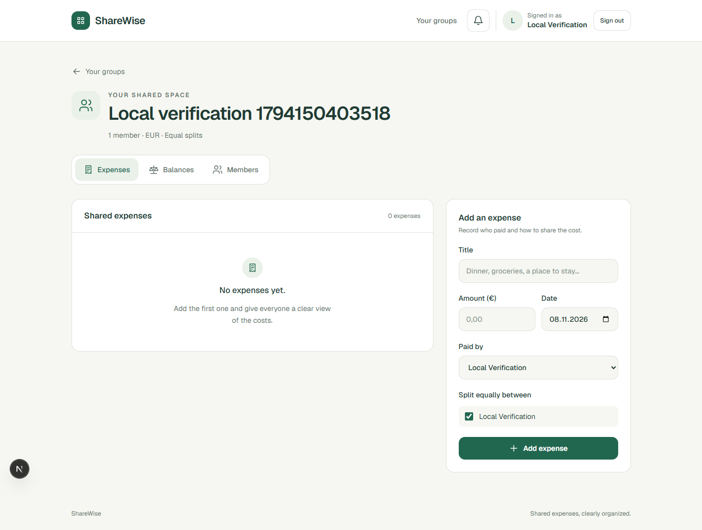

# Create-group failure: runtime diagnosis and fix

Date: 08 November 2026. Branch: `feature/ui-sign-in-clarity`.

## Report and confirmed cause

The user saw "Something went wrong." when submitting **Create group**.

The configured frontend backend address was `http://localhost:8080`. On this machine, port 8080 belonged to **Apache (`httpd`)**, not ShareWise. Both `/groups` and `/actuator/health` at that address returned HTML 404 pages. `/api/groups` forwarded the same HTML error. The API helper discarded the failed JSON parse and the message mapper had no useful fallback for the resulting unknown HTTP error.

ShareWise's database container was stopped because port 5432 was already used by another project's PostgreSQL. Inside the ShareWise database volume, only the `postgres` database existed; the `sharewise` database had not been created. The host's available Java was version 8, while ShareWise needs Java 21. These were concrete local setup problems; fixture-based visual tests could not establish that this real service chain worked.

An additional connectivity issue appeared during verification: the backend and Keycloak answered inside the Docker network, and the backend answered through a host network address, while Windows loopback requests timed out. The loopback listener was `wslrelay.exe`. Compose now binds project ports explicitly to `127.0.0.1`; verification of the browser flow is recorded below rather than inferred solely from container startup.

The running Keycloak realm also had the older `registrationEmailAsUsername=true` configuration, while current code
requires a separate username. Before changing anything, administration queries confirmed the ShareWise realm had
**zero users**. Its registration setting and user-profile configuration were aligned in place with the checked-in
realm file. No realm or user was deleted. Existing populated realms require a separate compatibility review; this
empty-realm correction is not an instruction to rename existing users automatically.

## Changes

| Change | Purpose |
|---|---|
| `frontend/src/lib/api.ts` | Preserve HTTP status for HTML/unparseable error pages, handle a null error body, and distinguish an invalid success response from a confirmed action |
| `frontend/src/lib/errors.ts` | Show actionable HTTP-specific messages instead of using "Something went wrong" for every unrecognized HTTP failure |
| `frontend/src/lib/currentUser.tsx` | Present an account-loading failure with a retry action, rather than silently leaving protected content visible without an identity |
| `backend/Dockerfile`, `backend/.dockerignore` | Build and run the existing backend with Java 21 and its Maven wrapper, without changing the host Java installation |
| Optional Compose `app` profile | Run the backend with its own PostgreSQL and Keycloak dependencies; standard host-backend instructions still exist |
| Compose database readiness check | Wait for PostgreSQL before starting the backend |
| Configurable loopback port mappings | Use backend 8081 and database 5433 on this machine, keeping Apache and the other project's PostgreSQL running |
| Local `frontend/.env.local` backend URL | Change only the public `BACKEND_URL` value to `http://localhost:8081`; this ignored file is not committed |
| Existing empty Keycloak realm | Match the versioned registration/user-profile settings without resetting identity-provider data |
| `RUNNING.md` | Save repeatable startup and diagnosis commands |

Keycloak remains on 8180; the public application remains on 3000. The backend validates the public Keycloak issuer while fetching signing keys through `http://keycloak:8080` on the Docker network. Supplying a JWK-set URI alongside the issuer retains issuer validation; see the [Spring Security resource-server documentation](https://docs.spring.io/spring-security/reference/servlet/oauth2/resource-server/jwt.html).

No migration file was edited. Existing volumes were retained, and the missing `sharewise` database was created alongside the existing `postgres` database. The fresh ShareWise database successfully applied all 16 existing migrations. This is evidence for a fresh installation, not for upgrading a populated older schema.

## Verification

- The real backend image built successfully using the Maven wrapper and Java 21. Its build skips integration-test execution; it does not replace a full backend `verify` run.
- Backend logs show successful application startup, schema validation and 16 applied migrations.
- Internal Docker HTTP requests returned 200 and health status `UP`; Keycloak's discovery endpoint also returned 200 internally.
- All **162 frontend tests** passed, including regression coverage for an HTML 404, an invalid JSON success body, a null error body and recovery from failed identity loading.
- Frontend lint, type checking and production build passed.
- The real-flow screenshot still reflects the original development server's cached stylesheet. The checked-in CSS
  and verified production build use the neutral theme; restart `npm run dev` manually if the old green theme remains.
- After explicit loopback bindings, external backend health and Keycloak discovery returned 200, and the signed-out frontend proxy returned the expected JSON 401 from ShareWise.
- **Real browser verification passed without API fixtures:** registered a dedicated diagnostic account on Keycloak, returned signed in to ShareWise, created a group (HTTP **201**), and reloaded the group page successfully. `/api/me` and group reads returned 200. One diagnostic account and one diagnostic group remain as test data; the generated password and tokens were kept only in memory and were not logged or saved.

An attempted restart of the existing frontend process was blocked by automatic approval review, with no detailed reason returned. The safer alternative succeeded: updating only its public backend address allowed Next.js to reload the environment file. No unrelated application process was stopped. The Docker services and the pre-existing frontend are left running for the user. This incident does not establish complete secret management, populated database-upgrade safety or a CI/CD implementation.

## Reading the failure correctly

The message in the screenshot was a fallback, not the root cause. Trace the request in order:

1. The browser submits `/api/groups` on Next.js.
2. Next.js forwards to the configured `BACKEND_URL`.
3. Confirm the service at that address is ShareWise before treating its response as a business-rule error.
4. Check the backend's database and identity-provider dependencies.
5. Verify a successful group creation and reload through the actual browser before declaring the flow fixed.

The remaining configuration, migration-upgrade and outage cases are tracked in [CI/CD special cases](2026-11-08-ci-cd-special-cases.md).
