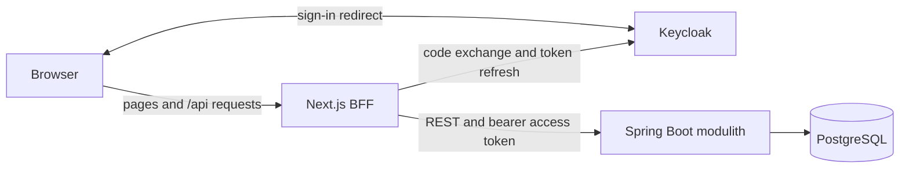
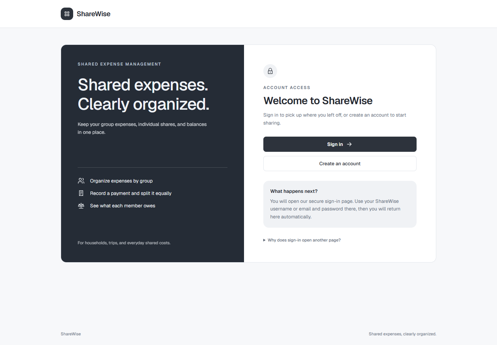
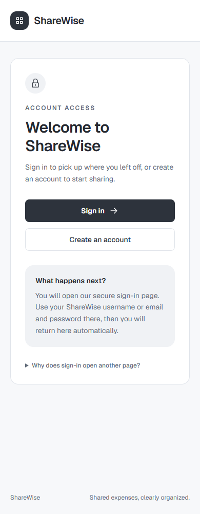
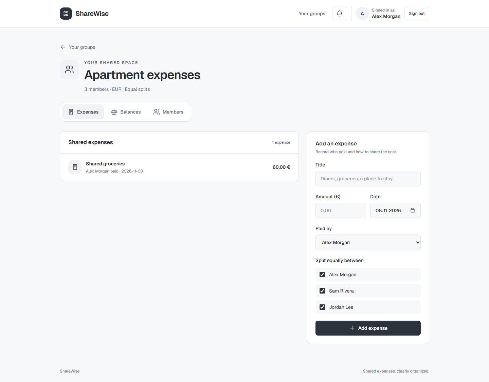
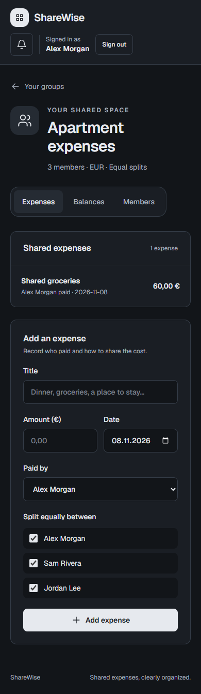

# ShareWise progress and handoff

Snapshot: 08 November 2026, Europe/Berlin. Working branch: `feature/ui-sign-in-clarity`, based on `fdb5ff2`.

Later runtime follow-up: the user's create-group failure exposed an Apache/ShareWise port conflict, a missing project
database and Windows loopback connectivity problems. A Java 21 backend image, optional Compose backend profile and
HTTP error handling were added. See [the incident record](2026-11-08-create-group-runtime-fix.md) for current verification;
the earlier fixture-only limits below describe the earlier UI work.

This document saves the work and conclusions from the project analysis, frontend implementation, authentication clarification and requirements review. It describes this checkout, not unmerged work by colleagues or the state of a hosted system. Source changes are saved locally and are not yet committed or merged.

## Working preferences and scope

- Explain theory and code step by step so the user can understand and defend the implementation. Execute changes when requested; avoid turning a discussion into unrelated implementation.
- The user selected **existing Keycloak accounts with clearer sign-in**. Social login and replacing the identity provider were not selected.
- The requested visual direction is **sleek and professional**: restrained colours, alignment, spacing, readable typography and a clear experience. Decorative colour is not the objective.
- The user requested that progress, decisions, verification and unresolved issues be saved in repository documentation.
- The user reports that a CI/CD implementation did not include some "special cases" and has clarified the first priorities: **environment variables and secrets, database migrations, and realistic failures that interrupt or crash the application**. The implementation location remains unspecified. Record observed source-level gaps separately from coverage claims about an uninspected pipeline.

## Current architecture

ShareWise has a Next.js frontend and a Spring Boot modular monolith backed by PostgreSQL. Keycloak owns credentials and identity-provider sessions.



The backend contains `account`, `group`, `expense`, `settlement` and `notification`, plus `shared` value types. Modules use public API ports and domain events; the module and convention tests enforce those boundaries.

Expense recording currently calls the Group membership port synchronously. The event-fed membership copy described in the decision documents is work on another branch, not the implementation in this checkout. Settlement consumes `ExpenseRecorded` asynchronously after commit, so balances can briefly lag expenses. Publications are persisted, duplicate expense bookings are guarded, and failed publications are retried on restart; scheduled retry and publication cleanup remain deliberately absent.

The earlier project analysis described the old built-in password/session implementation. That description is historical: current accounts use Keycloak. Invitations also changed from shareable links to invitations addressed to existing accounts, with acceptance/decline and notifications. Follow [RUNNING.md](../RUNNING.md), [the notifications review](review/notifications/REVIEW.md) and the current code for these flows.

### Remaining findings from the code review

These are observations to revisit when the relevant behavior is changed, not newly agreed requirements or reproduced production failures:

- Expense-ID deduplication is sufficient for initial booking but does not identify distinct correction/removal events for the same expense. Decide event identity/revisions before those operations are implemented.
- The runtime follow-up fixed silent non-401 identity-loading failures: `CurrentUserProvider` now shows an error and a retry action instead of protected content. The separate issue remains that `api()` does not centrally redirect every later 401, despite the frontend convention describing that behavior.
- The input money parser checks JavaScript's safe-integer range, but `amountToCents()` does not check that bound when reading API amounts. Very large amounts or accumulated balances need a consistent range policy.
- The domain avoids Spring services and servlet dependencies but uses JPA annotations, and application services use Spring Data repositories. Describe this accurately as domain-oriented layering with module ports; do not claim complete infrastructure independence.

The former custom-session expiry/revocation findings concerned code that has since been replaced by Keycloak; they must not be copied into a current defect list as if that implementation still exists.

### Concepts to learn from the code

Backend paths below are relative to `backend/src/main/java/de/hsh/favs/sharewise/`.

| Concept | Meaning here | Reading entry point |
|---|---|---|
| Bounded context | Each module owns a business responsibility and exposes a controlled public surface | Module `package-info.java` files; `ModularityTests` |
| Aggregate | Changes to memberships and invitations go through the Group root | `group/domain/Group.java` |
| Value object | IDs, money and names carry meaning and validation | `shared/Money.java`, `shared/UserId.java`, `group/domain/GroupName.java` |
| Application service | Coordinates validation, persistence, transactions and publishing | `expense/application/ExpenseService.java` |
| Exact splitting | Integer cents are divided; remainder cents go to the first participants | `expense/domain/EqualSplit.java` |
| Eventual consistency | The ledger is booked after the expense transaction commits | `settlement/application/ExpenseRecordedListener.java` |
| Idempotency | Repeated delivery must not book the same expense twice | `settlement/application/GroupLedgerService.java` |
| BFF | Next.js adapts browser cookies into backend bearer-token requests | `frontend/src/lib/backend.ts` from repository root |

A member's net balance is paid amounts minus owed shares. Positive means the member should receive money; negative means they owe money. Ledger entries for a correctly split expense sum to zero. The current UI does not implement settlement payments or a repayment plan.

## Work implemented in this session

The detailed design is in [Frontend experience and sign-in clarity](2026-11-08-frontend-experience-design.md).

| Area | Result | Main source files under `frontend/src/` |
|---|---|---|
| Shared visual system | Neutral light/dark tokens, Geist typography, common fields, panels, buttons, spacing and focus states | `app/globals.css`, `app/layout.tsx` |
| Sign-in | Clear sign-in/registration actions; explanation of the external page and existing username/email; compact mobile view | `app/login/page.tsx` |
| Failed sign-in | Fixed explanations for cancelled/expired attempts; safe destination retained for retry; transient login cookie cleared | `app/api/auth/callback/route.ts` |
| Groups | Responsive cards, clearer empty state, navigation and group creation guidance | `app/page.tsx`, `components/GroupList.tsx`, `components/CreateGroupForm.tsx`, `app/groups/new/page.tsx` |
| Group details | Aligned expense/form and members/invitation columns on desktop; stacked phone layout; keyboard-operated tabs | `components/GroupDetail.tsx`, `app/groups/[id]/page.tsx` |
| Expenses | Consistent labels and controls, participant selection, share preview and readable expense rows | `components/ExpenseForm.tsx`, `components/ExpenseList.tsx` |
| Balances | Text explains signed amounts and normal update delay | `components/BalancesTab.tsx` |
| Members and inbox | Member initials, invitation guidance, a dismissible inbox with Escape/outside-click support | `components/MemberList.tsx`, `components/InviteForm.tsx`, `components/InboxBell.tsx`, `components/AuthBar.tsx` |
| Common feedback | Consistent error and toast presentation | `components/ErrorBanner.tsx`, `components/Toast.tsx` |
| Local visual assets | Small SVG icons and decorative initials, without another dependency | `components/Icon.tsx`, `components/Avatar.tsx` |

Group creation now disables submission while its request is pending. Existing backend endpoints, financial rules, generated API types, Keycloak realm settings and credentials were not changed. The pre-existing `frontend/package-lock.json` edit was preserved; it is not part of the UI work.

### Authentication, step by step

1. The sign-in page links to `/api/auth/login` with a safe return path.
2. Next.js creates state and a PKCE verifier, remembers the flow in a short-lived HttpOnly cookie, and redirects to Keycloak.
3. The person enters credentials on Keycloak's page.
4. The callback checks the stored state and exchanges the authorization code using the verifier.
5. Tokens are kept in the existing HttpOnly cookie; the backend validates access tokens as an OAuth2 resource server.
6. The browser returns to its intended ShareWise page. Cancelled or expired attempts now explain what happened and retain that destination for retry.

OAuth 2.0/OIDC with Authorization Code and PKCE was already implemented before this UI work. We clarified its presentation and retry behavior; we did not add a second authentication scheme. Keycloak's own login theme was not redesigned.

## Verification and practical limits

| Check | Result in this session |
|---|---|
| Frontend ESLint | Passed |
| `npm run typecheck` | Passed |
| Frontend tests | All **157 tests in 22 files** passed with the command below |
| `npm run build` | Passed after the final UI changes |
| Desktop/phone browser review | Production preview at 1440 px and 390 px, light and dark themes; fixture-backed application screens |
| Browser errors and overflow | No page errors reported; no horizontal overflow on checked login, expense and inbox views |
| Real Keycloak handoff | Frontend returned 302 with `response_type=code`, `code_challenge_method=S256`; provider returned 200 with its login form |
| Complete login/logout with credentials | Not rerun |
| Backend Maven verification, contract lint and full browser journey | Not rerun in this session |

These rows describe the original UI pass. The later [runtime incident](2026-11-08-create-group-runtime-fix.md) added
four HTTP-error tests and one identity-recovery test, bringing the passing frontend total to **162**. It also verified
real Keycloak registration/sign-in, group creation (201) and group reload, and built/started the Java 21 backend in
Docker against a fresh database. Logout, the full multi-person expense journey and full backend integration tests
were not rerun in that follow-up.

```powershell
# Run from frontend/
npm run lint
npm run typecheck
node node_modules/vitest/vitest.mjs run --pool=threads --maxWorkers=2
npm run build
```

The first test run found an ambiguous inbox button selector after adding a close button. The selector was corrected. A subsequent default-fork run hit a Windows worker-start timeout; the bounded thread-pool run passed. This is an observed local execution issue, not evidence that a future CI runner needs the same workaround.

The local frontend checks ran on Node 20.19.6. The project's documented setup recommends Node 22+, so the local result is not evidence that a future CI job has already been verified on its intended Node runtime.

The expected Playwright-managed browser version was absent, so visual inspection used installed Chrome. No browser was installed. The initial development server retained old compiled CSS; a fresh production preview verified the final neutral colours. Restart the existing `npm run dev` process if the browser still shows the older theme. Temporary production preview processes started for inspection were stopped; the pre-existing development server was left running.

### Saved visual evidence

These captures use fictitious browser API fixtures. They establish layout and presentation, not backend correctness or successful account login. Copies are retained here because `.superpowers/` is ignored and is not durable repository documentation.









## Requirements review

Course expectations below come from [Requirements from the Prof](01_Requirements_from_Prof.md), the repository's summary of lecture material. The original slides were not independently reviewed in this session. Its explicit requirements and the team's inferences must not be confused.

| Scope | Requirement or commitment | Current assessment |
|---|---|---|
| Course, Ex4/Ex5 | Next.js frontend and Spring Boot modular monolith | Structure implemented; a fresh full-system verification remains |
| Team architecture | Business modules communicate through public ports/events | Implemented with architecture tests; backend tests were not rerun here |
| Current working slice | Sign in, create group, invite/accept/decline, record equal-split expenses, view balances and notifications | Present in code; UI checks do not replace end-to-end verification |
| User request | Professional, neutral UI and clear existing Keycloak sign-in | Implemented and checked as described above |
| Course, Ex6 | Create containers and execute locally | PostgreSQL, Keycloak and an optional backend service now exist; the frontend still runs on the host, so full application containerisation remains incomplete |
| Course, Ex7 | Create build pipelines | Local Git hooks exist; no CI pipeline definition was found in this checkout |
| Course, Ex8 | Adapt deployment pipeline for the course cloud | Not demonstrated by this checkout |
| Course, P2 | Explain implementation, limitations and change drivers | Design material exists; the presentation and deployment demonstration were not verified |

The repository notes list Ex6 on **09.11.2026**, Ex7 on **16.11.2026**, P2 on **17.11.2026** and Ex8 on **23.11.2026**. These dates are recorded course notes, not a fresh confirmation of the submission schedule.

The team's own domain model still lists unfinished group lifecycle operations, expense corrections/removal, exact/percentage splits, settlement payments/waivers, a simplified repayment plan, and account display-name/deactivation operations. See [diagram deltas](diagram-deltas.md). The notification feature is implemented even though one line still appears under that document's "Known gaps" heading. Do not treat every model operation as a professor-mandated minimum: the course summary says the minimum feature scope is unspecified.

The referenced original business rules file, `work/ShareWise_Requirements.md` (R1-R17 and journeys J1-J17), is outside this checkout and was unavailable. Full rule-by-rule compliance therefore has not been certified. An enum containing a future state does not establish that the operation exists.

## CI/CD and next steps

See [CI/CD special cases and coverage](2026-11-08-ci-cd-special-cases.md). It now records the confirmed priorities, configuration/secret inventory, eight concrete failure cases and separate migration acceptance checks for a fresh installation, populated upgrade and recovery. A pipeline in another branch or external configuration may exist; its absence from this checkout is not proof of absence everywhere.

Recommended order, subject to the team's agreed exercise scope:

1. Identify the authoritative business requirements and the CI/CD implementation the user is referring to. Start engineering work with configuration/secrets, migration safety and realistic interruption cases as the user requested; review findings are not yet implemented fixes.
2. Complete the application container setup and prove the browser, Next.js, backend, Keycloak and PostgreSQL work together with consistent URLs.
3. Run full backend and browser journeys; record results separately from frontend fixture checks.
4. Implement the build pipeline and then the deployment stage, explicitly covering the relevant cases in the CI/CD checklist.
5. Agree which remaining domain features belong in the current submission, and track them individually.

Further visual polish is a lower priority than those acceptance checks. Documentation is saved locally; no commit, push, merge, pipeline change or deployment was performed by this documentation step.
