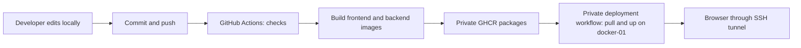

# ShareWise: from a local edit to the university VM

This guide explains the deployment verified on 19 November 2026 and the runner
setup completed on 20 November 2026. Tai Vinh is
currently the team's deployer. Other developers contribute code; they do not
need the VM password or registry token for ordinary development.

## 1. What we have working

The source repository used for publication is
[JoiningwithMattheus/sharewise](https://github.com/JoiningwithMattheus/sharewise).
GitHub Actions tests the code and publishes private Docker images to GitHub
Container Registry (GHCR). The private deployment workflow selects images and runs them on
the university VM `docker-01` (Proxmox VM 1019, in FAVS/G01).

Registration, creating/opening a group, logout and login were manually verified
on the VM. The frontend login page and Keycloak discovery endpoint returned
HTTP 200. This is evidence for those flows, not a claim that every feature or
recovery scenario has been tested.

The deployer subsequently confirmed that the expense, balance and persistence
checks also passed. On 20 November, a deployment runner was registered with the
private `JoiningwithMattheus/sharewise-deploy` repository and its systemd service
reported `active (running)`. The private deployment workflow was subsequently
implemented and its first forced deployment of the existing verified version
passed, including a database backup and service health checks (see section 12).

The lecturer's public GitLab `favsdemo` project taught the same build/publish/pull
idea. Our running ShareWise deployment uses our own GitHub images. The demo is
still a separate deployment on ports 3000/8080.



## 2. Concepts and responsibilities

| Term | Meaning in this project |
|---|---|
| Git repository | Source code, Dockerfiles, Compose configuration and workflow history. |
| CI: continuous integration | Automated lint, type checks, unit/integration tests and builds when code is pushed or a pull request changes. |
| Image | A packaged application and its runtime dependencies, built from a Dockerfile. |
| Registry | A server storing images. Our registry is `ghcr.io`; GitHub source code and GHCR images are different objects. |
| Container | A running instance of an image on a Docker host. |
| Compose | Describes the four services, networking, configuration and persistent volumes. |
| Continuous delivery | Successful code is automatically packaged and published, ready for deployment. |
| Continuous deployment | Automatically updating the running environment after checks pass. This final stage is not implemented here. |
| Volume | Persistent data kept independently of a container's lifecycle. |
| SSH tunnel | Forwards a laptop port to a service on the remote VM through an authenticated SSH connection. |

Our current result is CI plus automatic image delivery and a private scheduled
deployment workflow. Publication and VM deployment are separate runs: a green
source workflow is followed by the deployment check, which must also succeed.

Developers make related edits, test, commit, push their branches and review/merge
changes into the publishing repository's `main`. They should coordinate merges
with the deployer. The deployer watches the pipeline, records the chosen version,
updates the VM image references, deploys and checks the user flows. A colleague
can browse the VM application if they have their own authorized university SSH
access; they do not need registry credentials just to use the website.

## 3. Four services and their addresses

| Service | Role | Address used inside Docker | Published on the VM |
|---|---|---|---|
| Frontend | Next.js UI and server API handlers | `frontend:3000` | `127.0.0.1:3100` |
| Backend | Spring Boot application | `backend:8080` | No host port |
| Database | PostgreSQL application data | `db:5432` | No host port |
| Keycloak | Registration, login and identity | `keycloak:8080` | `127.0.0.1:8180` |

`localhost` always means the machine or container making the request. Thus
`localhost:8080` inside the frontend container would point back to the frontend,
not to Spring Boot. Compose's service names supply the internal addresses.

The browser opens `http://localhost:3100` on the laptop. SSH forwards that port
to port 3100 on the VM. Authentication also needs the tunnel for port 8180.
The frontend exchanges tokens at the internal Keycloak address, while browser
redirects and token issuer validation use the configured public address
`http://localhost:8180/realms/sharewise`. This is why both ports and the exact
`localhost` hostname matter. PostgreSQL port 5432 is not the website.

This is a private HTTP lab setup using Keycloak `start-dev` with persistent H2
identity storage. A public production deployment needs a separate HTTPS,
hostname, identity storage and operations design.

## 4. Know which terminal you are using

| Example prompt | Commands execute on |
|---|---|
| `PS E:\HannoverWS\FAVS\sharewise>` | Developer's Windows laptop |
| `student@docker-01:~/sharewise$` | University VM, after SSH login |

A terminal window displayed on your laptop can contain a remote VM shell.
Running Compose in local PowerShell operates local Docker Desktop; running it
after SSH login operates Docker on the VM.

Files to understand:

| File | Purpose |
|---|---|
| [containers.yml](../.github/workflows/containers.yml) | GitHub checks, builds and publication. |
| [compose.deploy.yml](../compose.deploy.yml) | Four-service deployment, project name `sharewise-lab`. |
| [deploy.env.example](../deploy.env.example) | Blank template for private deployment settings. |
| `.env.deploy.local` | Actual passwords and selected image references; excluded from Git. |
| [sharewise-realm.json](../docker/keycloak/sharewise-realm.json) | Initial Keycloak realm/client configuration. |
| [DEPLOYING.md](../DEPLOYING.md) | Technical configuration and local container instructions. |

## 5. Developer: commit, push and publish

Use your own local clone path; `E:\HannoverWS\FAVS\sharewise` is the deployer's
current checkout. Local checks require Node 22+, Java 21 and running Docker for
the backend integration tests. Enable the repository's hooks once:

```powershell
cd E:\HannoverWS\FAVS\sharewise
git config core.hooksPath .githooks
git switch -c feature/your-change
# Edit and test your change, then inspect what you will commit.
git status
git diff
git add <specific-files-you-changed>
git commit -m "feat(scope): describe your change"
git push -u origin feature/your-change
```

Replace placeholders before running commands. Commit related work together;
there is no need to publish a deployment after each file edit. Open a pull
request into the publishing repository's `main`, wait for checks and review,
then merge. Check the remote URL with `git remote -v`: pushing to another fork
does not update `JoiningwithMattheus/sharewise` or its deployment.

The push hook prints one check label and buffers its output until completion.
Backend verification can take several minutes while Testcontainers starts real
PostgreSQL and Keycloak. Let it finish; do not bypass checks with `--no-verify`.

Open [GitHub Actions](https://github.com/JoiningwithMattheus/sharewise/actions).
The workflow has `frontend`, `backend` and `images` jobs. Branches and pull
requests build images without publishing. Only a successful run on the default
branch publishes. Frontend checks include lint, type checking, Vitest and API
contract lint; backend checks use Maven `verify`. Browser E2E is a separate check.

After all jobs pass, copy the two image references from the run summary. Both
must come from the same successful run. The first deployed version was:

```dotenv
FRONTEND_IMAGE=ghcr.io/joiningwithmattheus/sharewise/frontend:sha-c22ad0092dd6ff66820361b9bfad5a7c84872870
BACKEND_IMAGE=ghcr.io/joiningwithmattheus/sharewise/backend:sha-c22ad0092dd6ff66820361b9bfad5a7c84872870
```

These are historical example references. For a new release use the new run's
references. The suffix identifies the full source commit, rather than a moving
`latest` version. Tags can technically be overwritten; image digests provide
strict immutable references when needed.

## 6. Deployer: first-time VM preparation

This is already prepared on our VM. Do not regenerate its existing passwords
or recreate volumes on every release.

University SSH access must already be configured for the deployer's own account
and public key. `edudscloud_hsh` is the university SSH entry alias;
`edudscloud_lab` is the lab gateway alias using that entry as a jump host. These
aliases live in the laptop's SSH configuration, not in Git. Each colleague uses
their own authorized account/key; do not copy another person's private key.

From Windows:

```powershell
ssh -J edudscloud_lab student@192.168.181.2
```

The known VM interfaces are `192.168.181.2` (group network) and `10.0.30.184`
(university network). Verify current addresses in Proxmox/the VM if they change.
An alternative tested route is through the entry server directly:

```powershell
ssh -J edudscloud_hsh student@10.0.30.184
```

Before accepting a new host key, check it against the intended VM. University
login, VM login and registry login are three separate authentication steps.

On the VM create `~/sharewise` and `~/sharewise/docker/keycloak`. Transfer the
version-controlled `compose.deploy.yml`, `deploy.env.example` and
`docker/keycloak/sharewise-realm.json`, retaining their relative paths. Example
from a second Windows terminal, using the alternative route:

```powershell
scp -J edudscloud_hsh compose.deploy.yml deploy.env.example student@10.0.30.184:sharewise/
scp -J edudscloud_hsh docker/keycloak/sharewise-realm.json student@10.0.30.184:sharewise/docker/keycloak/
```

On the VM, for a new installation only, copy `deploy.env.example` to
`.env.deploy.local`, set two distinct private passwords and the selected image
references, and run `chmod 600 .env.deploy.local`. Never commit or share that file.

Our GHCR images are private. The deployer authenticates on the VM using a GitHub
personal access token (classic) with `read:packages`, belonging to an account
with access to these packages:

```bash
docker login ghcr.io -u JoiningwithMattheus
```

Paste the token at the password prompt; no characters appear. Use a GitHub token,
not a GitLab token or university password. Login grants download access; it does
not download images or start containers. GitHub Actions separately uses its
built-in `GITHUB_TOKEN` with `packages: write` for publication. Tokens must never
appear in commits, screenshots, Compose files or chat.

## 7. Deployer: deploy a published version

Run on the VM, one command at a time; stop if a command fails:

```bash
cd ~/sharewise
nano .env.deploy.local
# Update FRONTEND_IMAGE and BACKEND_IMAGE from the successful workflow summary.
# Preserve DB_PASSWORD and KEYCLOAK_ADMIN_PASSWORD.
docker compose --env-file .env.deploy.local -f compose.deploy.yml config --quiet
docker compose --env-file .env.deploy.local -f compose.deploy.yml pull
docker compose --env-file .env.deploy.local -f compose.deploy.yml up -d --no-build
docker compose --env-file .env.deploy.local -f compose.deploy.yml ps
```

In nano, save with Ctrl+O, Enter, and exit with Ctrl+X. `config --quiet` checks
configuration without printing interpolated secrets. `pull` downloads the
selected images. `up` creates/recreates services using them. `--no-build` ensures
the VM uses published images; there is no source build on the VM.

`~/sharewise` is not a Git clone, so `git pull` there reports "not a git
repository". That is expected. Source edits travel through the workflow into
images. If a release also changes Compose or realm configuration, transfer and
review those files as well; pulling images does not update host-side files.
Realm import is initialization, not a way to update an already initialized realm.

## 8. Check readiness and browser access

Containers marked `Up` may still be starting. After warm-up, run on the VM:

```bash
curl -s -o /dev/null -w 'Frontend HTTP %{http_code}\n' http://localhost:3100/login
curl -s -o /dev/null -w 'Keycloak HTTP %{http_code}\n' http://localhost:8180/realms/sharewise/.well-known/openid-configuration
docker compose --env-file .env.deploy.local -f compose.deploy.yml exec -T frontend node -e "fetch('http://backend:8080/actuator/health').then(async r=>{console.log(r.status,await r.text());if(!r.ok)process.exitCode=1}).catch(e=>{console.error(e.message);process.exitCode=1})"
```

Expect HTTP 200 for the pages and HTTP 200/status `UP` for backend health.
In a separate Windows terminal, establish the browser tunnel:

```powershell
ssh -J edudscloud_lab -N -o ExitOnForwardFailure=yes -L 3100:127.0.0.1:3100 -L 8180:127.0.0.1:8180 student@192.168.181.2
```

Enter requested passwords and leave the terminal open. `-N` intentionally opens
no shell; a blank terminal after authentication is normal. Browse
http://localhost:3100 and exclude `localhost`/`127.0.0.1` from Firefox's proxy.
The SSH jump route does not require a separate OpenVPN connection.

If local ShareWise occupies these ports, stop its local stack first from its
Windows repository directory:

```powershell
docker compose --env-file .env.deploy.local -f compose.deploy.yml stop
```

Then retry the tunnel. Local and VM volumes are separate. An existing laptop
account will not exist in a fresh VM Keycloak database. Check registration,
login, creating/opening a group, adding an expense, balances and logout/login.
Record the deployed commit and results. Inspect request failures in the browser's
Network panel as well as server logs.

## 9. Logs, updates and persistent data

On the VM:

```bash
cd ~/sharewise
docker compose --env-file .env.deploy.local -f compose.deploy.yml logs --tail=100 --timestamps
docker compose --env-file .env.deploy.local -f compose.deploy.yml logs -f --tail=30 frontend backend
# Or authentication logs:
docker compose --env-file .env.deploy.local -f compose.deploy.yml logs -f --tail=30 keycloak
```

Ctrl+C stops watching logs, not the application. Successful requests may produce
no log entry because HTTP access logging is not enabled. Share relevant errors
after removing tokens, cookies, passwords and personal data.

For the next release repeat section 5 and section 7, then the checks in section
8. Container recreation retains `sharewise-lab_database` and
`sharewise-lab_identity`. Do not run `down -v` on retained data. Changing password
variables does not rotate passwords in already initialized databases.

Before upgrades, back up application and identity data and review database
migrations. Returning image references to a previous successful version and
running `pull`/`up` can restore application binaries, but does not reverse a
schema migration. A database restore/compatible migration plan may be required.
The branch contains historical destructive migrations, so do not reuse an
existing unrelated database for this deployment.

## 10. Troubleshooting

| Symptom | Check/action |
|---|---|
| Docker Desktop Linux engine pipe missing | Local engine is unavailable. Start Docker Desktop for local commands, or confirm you meant to run the command in the VM shell. |
| `git pull`: not a repository on VM | Expected with our deployment-only directory. Pull images with Compose. |
| GHCR denied/unauthorized | Check package access, token expiry and `read:packages`; log in to `ghcr.io` on the VM as the same OS user running Compose. |
| Image/tag not found | Use both exact references from a fully successful default-branch run. |
| Compose configuration not found | `cd ~/sharewise` and pass `-f compose.deploy.yml`. |
| YAML scanner error | A downloaded file may be an HTML login/error page. Transfer the actual repository file; inspect it before use. |
| `registry.gitlab.gwdg.de` DNS failure | It is not our ShareWise registry. Our images use `ghcr.io`; the lecturer's sample used `docker.gitlab.gwdg.de`. |
| SSH says `Permission denied (publickey)` | Check the university account's authorized public key and SSH identity. Registry tokens cannot authenticate SSH. |
| Blank terminal after tunnel password | Expected with `-N`. Keep it open and use another terminal/browser. |
| Local port already in use | Check for a local stack/older tunnel. Stop only the process you identified, then retry. |
| Login redirects fail | Check both tunnels, exact localhost URLs, Keycloak readiness and logs. |
| Vitest worker-startup timeout | Our local suite passed with thread pool/one worker. Do not ignore unhandled errors; inspect the saved Vitest configuration and available RAM. |
| React `act(...)` warning | A test synchronization warning; distinguish it from a failed assertion or worker error. |

## 11. Private deployment repository and runner (20 November)

The next stage uses the private repository
[JoiningwithMattheus/sharewise-deploy](https://github.com/JoiningwithMattheus/sharewise-deploy).
The public ShareWise source repository retains the existing GitHub-hosted build
jobs. The private repository will contain deployment automation only; no source
migration is required. Only trusted deployment maintainers should have write
access to it. GitHub recommends private repositories for self-hosted runners:
public pull-request workflows can otherwise expose the runner machine.

```text
Public ShareWise repository: checks -> build -> private GHCR images
                                                 |
Private sharewise-deploy repository: scheduled/manual deployment job
                                                 |
                                  runner on docker-01 -> Compose -> health checks
```

A runner is an agent that connects outward to GitHub, waits for a job and runs
its commands on the VM. The service does not automatically watch for new images
or update Compose by itself. Its deployment commands will execute as `student`,
which already has Docker access and the saved GHCR read-only login. The runner
therefore has meaningful control over the VM's Docker workloads. Do not add
untrusted workflows or pull-request triggers to this deployment repository.

### Setup that was completed

In the VM shell, the deployer checked the account, host, Docker and architecture:

```bash
whoami
hostname
docker info --format '{{.ServerVersion}}'
uname -m
mkdir -p ~/actions-runner-sharewise
cd ~/actions-runner-sharewise
```

The intended values are `student`, `docker-01`, a Docker version and `x86_64`.
In the private repository, use **Settings -> Actions -> Runners -> New self-hosted
runner**, select **Linux / x64**, and follow GitHub's current download, checksum,
extraction and registration commands. Do not hard-code an old runner download
version in this guide. Registration uses a short-lived token supplied by GitHub;
it is different from the GHCR `read:packages` token and must not be committed.

Configuration values:

| Setting | Value |
|---|---|
| Repository | `JoiningwithMattheus/sharewise-deploy` (private) |
| Runner directory | `/home/student/actions-runner-sharewise` |
| Runner account | `student` (observed UID/GID 1001) |
| Runner name | `docker-01-sharewise` |
| Additional label requested during setup | `sharewise-deploy` |
| Work directory | Default `_work` |

Run `./config.sh` as `student`, not root. A foreground connection test uses
`./run.sh`; after it connects and listens for jobs, Ctrl+C stops that foreground
process. The background service was installed and started with:

```bash
cd ~/actions-runner-sharewise
sudo ./svc.sh install student
sudo ./svc.sh start
sudo ./svc.sh status
```

Do not repeat registration or service installation on an already configured
runner. The supplied status output confirmed this unit is enabled and active:

```text
actions.runner.JoiningwithMattheus-sharewise-deploy.docker-01-sharewise.service
Active: active (running)
```

Enabled means systemd will start it at boot; running means its process is alive.
Check the private repository's Runners page for **Idle** when it is connected
and available. Confirm its `sharewise-deploy` label there before targeting the
label in a workflow. An active process alone does not establish GitHub reachability.

### Runner operations and logs

Run on the VM:

```bash
cd ~/actions-runner-sharewise
sudo ./svc.sh status
sudo journalctl -u actions.runner.JoiningwithMattheus-sharewise-deploy.docker-01-sharewise.service -n 50 --no-pager
```

For live runner logs, use the same `journalctl` command with `-f` instead of
`-n 50 --no-pager`. Ctrl+C ends log watching. Runner diagnostics also live under
`~/actions-runner-sharewise/_diag`. These are runner logs, not application logs;
use the Compose commands in section 9 for ShareWise errors.

To stop/start job reception deliberately, use `sudo ./svc.sh stop` and
`sudo ./svc.sh start` from the runner directory. Stopping the runner does not
stop the already running ShareWise containers. Closing the laptop's SSH session
also leaves the runner service and application running. Browser access still
needs the laptop tunnel in section 8.

## 12. Automatic deployment implemented (20 November)

The private repository now contains `.github/workflows/deploy.yml`, `deploy.py`,
selection/environment regression tests and its own operations README. The runner
was confirmed online with the required label. Workflow validation and four unit
tests passed. The [first deployment run](https://github.com/JoiningwithMattheus/sharewise-deploy/actions/runs/44643313988)
completed successfully with `force` enabled for the already verified publication
`c22ad0092dd6ff66820361b9bfad5a7c84872870`.

The log confirmed Compose startup, PostgreSQL backup, saved previous settings and
healthy frontend, Keycloak and backend. This exercised deployment of the existing
version; deployment of a new version awaits the next successful main publication.

Instead of placing a cross-repository dispatch token in the public repository,
the private workflow checks the public publication status every five minutes.
GitHub schedules can be delayed; this is automatic polling, not an immediate
push-triggered update. It selects the latest main push only if its publication
completed successfully. A newer failed/pending publication prevents automatic
selection of an older run. No public source code or artifacts execute on this
runner; only the private deployment code runs there.

For a new version the script validates the SHA, pulls the two application images,
saves `.env.deploy.previous` privately, dumps PostgreSQL into `~/sharewise/backups`,
updates both image references without changing passwords and runs Compose with
`--no-build --pull never`. PostgreSQL/Keycloak images are not automatically
upgraded. It waits up to four minutes for all three application services to pass
health checks. Workflows are serialized and a VM file lock protects deployment.
An already selected healthy version is skipped on later checks.

If startup or health checks fail, `.deploy-failed-sha` stops scheduled retries of
that version; a manual run can retry it. A newer successful publication can still
deploy. Inspect VM logs and review migration compatibility before restoring
previous settings. No automatic rollback runs against a potentially changed
schema. PostgreSQL dumps do not back up Keycloak H2 identity data; maintain a
separate consistent identity backup. Backups accumulate and need disk-space and
retention management.

For manual deployment/retry, open the private repository's **Actions -> Deploy
ShareWise to docker-01 -> Run workflow**, select `main` and enter an optional full
SHA from a successful main push. Blank selects the latest main push. `force`
exercises the deployment path even if that version is already healthy. Disable
the workflow in Actions to pause automation. Stopping only the runner leaves jobs
queued. The latest observed source run failed frontend lint in `MemberList.tsx`
line 37; the automated deployer therefore keeps the working VM version until a
successful publication is available. This is a dated observation, not a permanent
configuration limitation.

Background references:
[GitHub image publication](https://docs.github.com/en/actions/tutorials/publish-packages/publish-docker-images),
[GHCR](https://docs.github.com/en/packages/working-with-a-github-packages-registry/working-with-the-container-registry),
[Self-hosted runner security](https://docs.github.com/en/actions/reference/security/secure-use),
[Runner installation](https://docs.github.com/en/actions/how-tos/manage-runners/self-hosted-runners/add-runners),
[Docker Compose](https://docs.docker.com/compose/).
