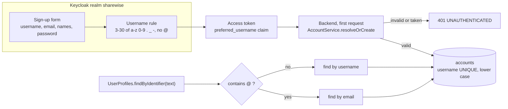

# Feature 1: usernames and the exact lookup

**Why.** To invite a known person you need a stable, human name to type. Keycloak owns it (sign-up form); ShareWise copies it once on first login, like email and display name (decision D10). Lookup is exact on username or email, never fuzzy.

Commits: `169c319` (backend, realm, docs), `50cffb3` (contract, the `username` fields). About 117 lines of production backend code.

## Flow



## Backend: what to look at (in this order)

| File | Look for |
|---|---|
| `account/domain/Username.java` (30 lines) | the rule: lower case, trimmed, 3 to 30 characters, **never an `@`**. Why: the lookup tells an email from a username by the `@`; a username like `bob@example.com` would catch the real Bob's invitations. |
| `account/application/AccountService.java` | first login: invalid username answers 401 and saves nothing; the log line for the lost-race case now names email *or* username |
| `account/persistence/AccountRepository.java` | `insertIfAbsent` uses `ON CONFLICT DO NOTHING`, which swallows **any** unique conflict. Known and accepted (same as the email case). |
| `account/application/UserProfilesImpl.java` | `findByIdentifier`: trim, lower case, exact equality (no `LIKE`), inactive accounts are not found, no transaction needed |
| `db/migration/account/V106__account_username.sql` | `NOT NULL` + unique index with **no backfill** (the dev database is recreated; an existing database with accounts fails to migrate) |
| `docker/keycloak/sharewise-realm.json` | `registrationEmailAsUsername: false`, `editUsernameAllowed: false`, the username pattern in the declarative user profile. **Open question:** does the user-profile `edit` permission let users rename themselves in the account console? |

Tests that pin it: `account/domain/UsernameTest`, `account/application/AccountServiceTest`, `UserProfilesImplTest` (wildcards `%` `_`, blank, inactive, "never called /me"), `account/web/AccountControllerTest.meReturnsTheUsername`, `KeycloakUsersTest.theRealmRefusesAUsernameWithAnAtSign` (proves the realm rule against a real Keycloak).

## Frontend: what to look at

Almost nothing changed here on purpose: sign-up and login are Keycloak's pages. Check:
- `frontend/e2e/mallorca.spec.ts`: registration fills "Username", login uses "Username or email".
- `frontend/src/api/schema.d.ts` is generated, do not read it line by line.

## Diff commands

```sh
PKG=backend/src/main/java/de/hsh/favs/sharewise; TST=backend/src/test/java/de/hsh/favs/sharewise; D="git diff -w --ignore-cr-at-eol"
$D main...HEAD -- $PKG/account backend/src/main/resources/db/migration/account docker/keycloak
$D main...HEAD -- $TST/account $TST/KeycloakUsers.java $TST/KeycloakUsersTest.java
```

## Questions to ask yourself
- Is any path able to create an account without a valid `Username`?
- Could two different people end up resolving to the same identifier (case, spaces, `@`)?
- Is it acceptable that a stored username can go stale if Keycloak lets users rename themselves?
