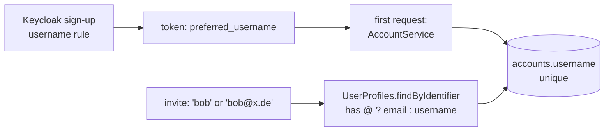

# 1. Usernames and the exact lookup

To invite a known person you need a name to type. Keycloak owns the username (sign-up form); ShareWise copies it once on first login. Lookup is exact on username or email, never fuzzy. Commit `169c319` (small: about 117 lines of production code).



**Start here:** `account/domain/Username.java` (30 lines), then `AccountService.java`.

| Look at | For |
|---|---|
| `Username.java` | no `@` allowed, ever: the lookup tells email from username by the `@` |
| `AccountService.java` | an invalid username on first login is a 401 and saves nothing |
| `UserProfilesImpl.java` | exact equality, no `LIKE`, inactive accounts not found |
| `V106__account_username.sql` | `NOT NULL` with no backfill: an existing database must be wiped |
| `docker/keycloak/sharewise-realm.json` | the username rule in the realm; open question: can users rename themselves? |
| frontend | nothing to read: sign-up is Keycloak's page; only `e2e/mallorca.spec.ts` fills the new field |

**Tests:** `UsernameTest`, `UserProfilesImplTest` (wildcards, blank, inactive), `KeycloakUsersTest` (the realm refuses `bob@example.com`).

```sh
D="git diff -w --ignore-cr-at-eol"; PKG=backend/src/main/java/de/hsh/favs/sharewise
$D main...HEAD -- $PKG/account backend/src/main/resources/db/migration/account docker/keycloak
```
