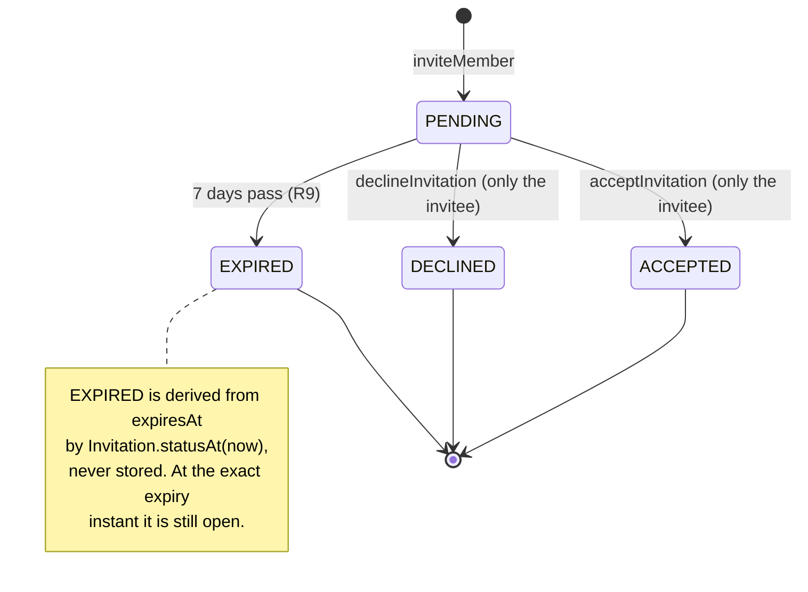
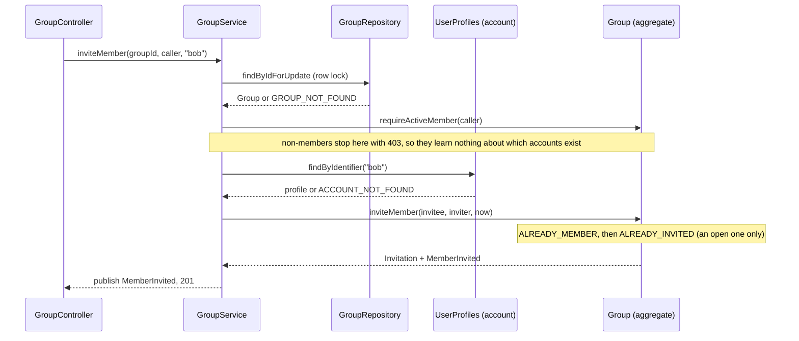
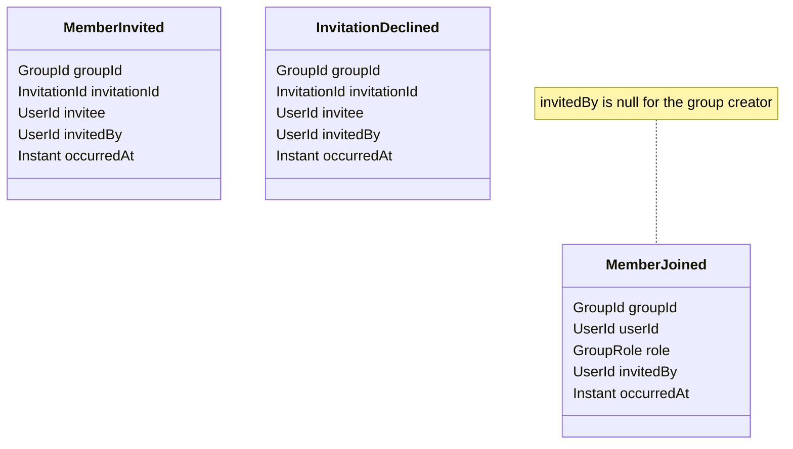

# Feature 2: invitations to an account

**Why.** The old invitation was a link anyone could use. Now an invitation belongs to one existing account; only that account can accept or decline; "my open invitations" is a query, not an inbox row (design review, N9). About 483 lines of production backend code, the biggest rule set of the branch.

Commits: `13b9c54` (domain, service, web, migration), `1f8346c` (projection query instead of lazy loading), `50cffb3` (contract).

## The life of an invitation



## The order of the checks in `inviteMember` (security relevant)



## Events (ids only, they become messages later)


`MemberInvited` has no consumer yet (a later email channel would be one).

## Backend: what to look at (in this order)

| File | Look for |
|---|---|
| `group/domain/Invitation.java` (76) | `statusAt(now)` (derived expiry, boundary), `requireAnswerableBy`: someone else's invitation and an already answered one look the same (`INVITATION_NOT_FOUND`), so ids cannot be probed |
| `group/domain/Group.java` | `requireActiveMember`, `inviteMember` (check order), `acceptInvitation`, `declineInvitation`, `pendingInvitationsFor`; each returns its event, none publishes |
| `group/application/GroupService.java` | **lock first** (`findByIdForUpdate`), membership **before** the account lookup, `acceptInvitation`/`declineInvitation` lock through `lockedGroupOfInvitation`, `listPendingInvitations` is a read use case on plain rows |
| `group/persistence/GroupRepository.java` | `findPendingInvitationsFor`: the open-invitation rule asked of the database (`expiresAt >= :now`, same boundary as `statusAt`), `PendingInvitationRow` |
| `db/migration/group/V205__invitations_for_accounts.sql` | **no unique index** on (group, invitee) on purpose: EXPIRED is derived, so no index could tell open from expired; the group row lock is the single guard. Why V205 not V204: `feature/settlements` already owns V204. |
| `group/web/GroupController.java` + records | `POST /groups/{id}/invitations` (body `identifier`, Bean Validation), `GET /invitations`, `POST /invitations/{id}/accept`, `.../decline` |
| `group/api/*` | the three event records; `MemberJoined.invitedBy` is nullable by design |

Tests that pin it: `group/domain/GroupTest` (18: expiry boundary, re-invite after 7 days, someone else's invitation, double accept), `GroupServiceTest` (lock, order, nothing saved when refused), `group/web/InvitationControllerTest` (26: status codes, wildcards, `403` before `404`), `MallorcaSliceTest` (field names exactly as the contract).

## Frontend: what to look at

| File | Look for |
|---|---|
| `components/InviteForm.tsx` (61) | trims, blank is not sent, button disabled while sending, "Invitation sent to @username", errors through `messageFor` |
| `components/InboxBell.tsx` (accept/decline part) | Accept disables its buttons while the call runs; a **404 after accept counts as done** (answered in another tab), any other error is shown |
| `app/api/invitations/[invitationId]/accept|decline/route.ts` | one-line proxies, same shape as the others |
| deleted | `JoinGroup`, `InviteButton`, `app/join/[token]`, `app/api/invitations/[token]` (the link flow) |

## Diff commands

```sh
PKG=backend/src/main/java/de/hsh/favs/sharewise; TST=backend/src/test/java/de/hsh/favs/sharewise; D="git diff -w --ignore-cr-at-eol"
$D main...HEAD -- $PKG/group backend/src/main/resources/db/migration/group
$D main...HEAD -- $TST/group
$D main...HEAD -- docs/api/openapi.yaml            # the contract for invitations and the inbox
git show 1f8346c                                    # the lazy-loading fix on its own
$D main...HEAD -- frontend/src/components/InviteForm.tsx "frontend/src/app/api/invitations"
```

## Questions to ask yourself
- Can any sequence of calls leave two open invitations for the same person and group? (Two parallel invites are serialized by the lock; there is deliberately no thread test.)
- Is the boundary right: valid at exactly `expiresAt`, expired one second later?
- Should a non-member really get `403` before anything about the account is revealed? (Yes, that is the point of the order.)
- Known gaps, parked with a trigger: inviting to a closed or archived group, and re-inviting a former member (`uq_memberships_group_user`). Neither can happen until `closeForSettlement`, `leaveGroup` and `removeMember` exist.
