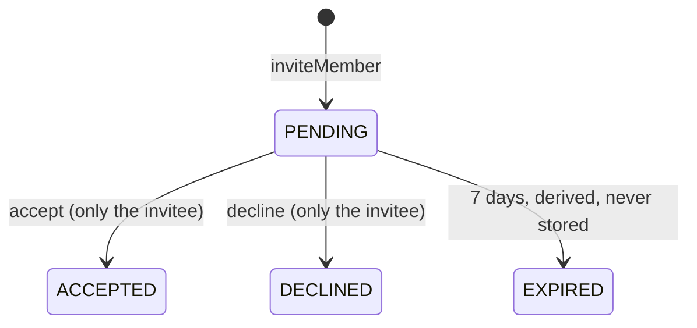

# 2. Invitations to an account

The old invitation was a link anyone could use. Now it belongs to one existing account, only that account can accept or decline, and "my open invitations" is a query. This holds the main rules (the biggest part, about 483 lines). Commits `13b9c54`, `1f8346c` (one projection query instead of lazy loading).



**Start here:** `group/domain/Invitation.java` (76 lines), then `Group.java`, then `GroupService.java`.

| Look at | For |
|---|---|
| `Invitation.java` | `statusAt(now)`: expiry is derived; valid at the exact expiry instant, expired one second later. Someone else's invitation and an answered one both give `INVITATION_NOT_FOUND`. |
| `Group.java` | `inviteMember` (checks: member, not already member, no open invitation), `acceptInvitation`, `declineInvitation`; each returns its event |
| `GroupService.java` | lock the group first; check membership **before** looking up the account, so a non-member learns nothing about who has an account |
| `GroupRepository.java` | `findPendingInvitationsFor`: one query returning plain rows |
| `V205__invitations_for_accounts.sql` | deliberately no unique index (expiry is derived); the lock is the guard. V205 not V204: settlements already owns V204 |
| frontend | `InviteForm.tsx` (61 lines: trims, blank not sent, shows `@username`); Accept and Decline live in `InboxBell.tsx` (a 404 after accept counts as "already done") |

**Tests:** `GroupTest` (expiry boundary, re-invite, someone else's invitation), `InvitationControllerTest` (status codes, `403` before `404`).

```sh
D="git diff -w --ignore-cr-at-eol"; PKG=backend/src/main/java/de/hsh/favs/sharewise
$D main...HEAD -- $PKG/group backend/src/main/resources/db/migration/group
$D main...HEAD -- frontend/src/components/InviteForm.tsx
```
Parked: inviting to a closed group and re-inviting a former member cannot happen until those operations exist.
