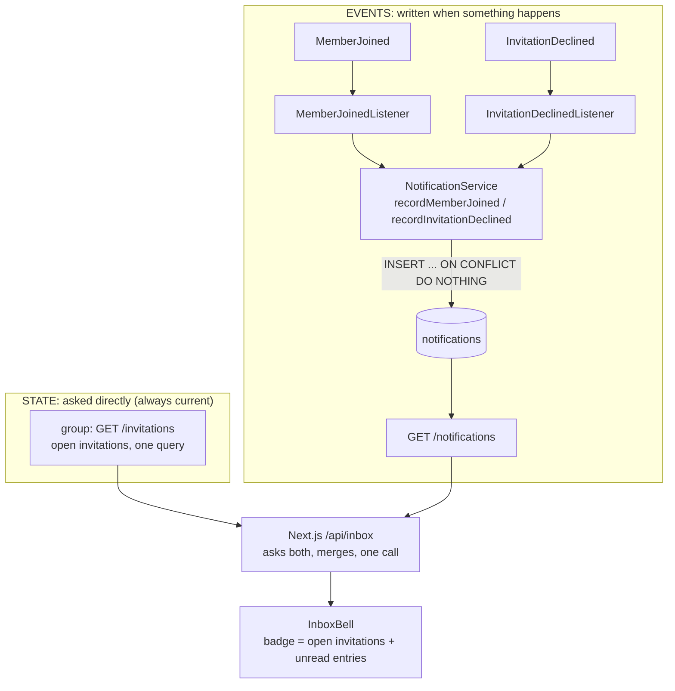
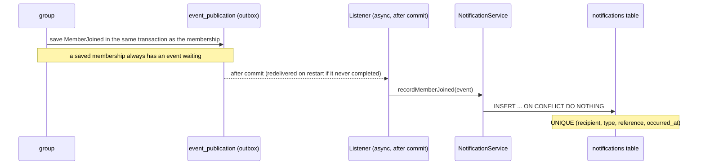
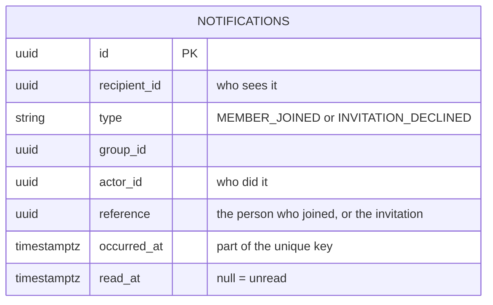
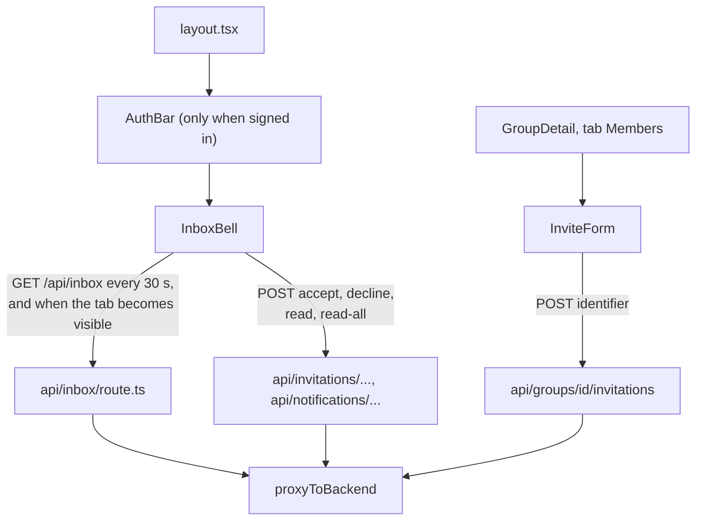

# Feature 3: the notification module and the bell

**Why.** One place in the app that tells a person what matters: open invitations to answer and things that happened ("Bob joined", "Carol declined"). It is its own **leaf module**, so later events (payments, waived debts) are one listener each, and nothing else ever depends on it. About 495 lines of production backend and 455 of frontend.

Commits: `aea3375` (module), `4a360fa` (bell, invite box, route handlers), `1be8fbe` (review fixes), `50cffb3` (contract).

## Two sources, one bell


Why split: "which invitations are open for me?" is a question about **current state**, so a stored copy could go stale and a failed listener could hide an invitation for days. Entries record **what happened**, which is exactly what an event is for.

## Delivery: why a redelivered event cannot create a second entry




No foreign keys: the ids belong to other modules. Names and texts are **not stored**; they are looked up when the inbox is read (`UserProfiles`, `GroupDirectory`), so names can change.

## Backend: what to look at (in this order)

| File | Look for |
|---|---|
| `notification/package-info.java` + `ConventionTests.nothingDependsOnTheNotificationModule` | allowed dependencies `account::api, group::api, shared`, and the rule that nothing depends on it. **No `api` package** because nobody may use it. |
| `notification/domain/Notification.java` (111) | ids only, immutable except `readAt`, `markRead` keeps the first time |
| `db/migration/notification/V501__notifications.sql` | the unique key and **why `occurred_at` is in it** (a person who leaves and rejoins must not be dropped as a duplicate) |
| `notification/application/NotificationService.java` (135) | `recordMemberJoined` skips the creator (`invitedBy == null`); `list` resolves names through the ports and gives `null` actor or group when it cannot; `markRead` of another person's entry is `NOTIFICATION_NOT_FOUND` |
| `notification/application/*Listener.java` | thin on purpose: `@ApplicationModuleListener` is asynchronous, the logic is in the service so tests can call it directly |
| `notification/persistence/NotificationRepository.java` | `insertIfAbsent` (native, `ON CONFLICT DO NOTHING`), `findInbox`, `markAllRead` |
| `notification/web/NotificationController.java` | `limit` is validated here with `@Min(1) @Max(50)`; every call is about the caller's own entries |
| `group/api/GroupDirectory.java` + `GroupDirectoryImpl` | the one port added to `group`: names for a set of ids, no transaction needed |

Tests that pin it: `notification/domain/NotificationTest`, `notification/application/NotificationEventsTest` (same event twice, rejoin, creator), `notification/web/NotificationControllerTest` (13: the **real flow** with Awaitility proves the async wiring, foreign ids are 404, limits), `group/application/GroupDirectoryImplTest` (no transaction), `ModularityTests`, `ConventionTests`.

## Frontend: what to look at



| File | Look for |
|---|---|
| `app/api/inbox/route.ts` (29) | the one handler without a single backend endpoint (documented exception in convention 04): asks `/invitations` and `/notifications?limit=10`, a failed part becomes `null`, a **401 from either is passed on**, the refreshed session cookie is forwarded |
| `components/InboxBell.tsx` (187) | badge = open invitations + unread entries; polling stops after a 401; Accept/Decline/mark-read each reload the inbox; **names are rendered as React text, never HTML** (test with ``); partial failure shows what loaded |
| `components/InviteForm.tsx` | see feature 2 |
| `lib/errors.ts` | messages for the three new error codes; "No account found. The person must have signed in to ShareWise once." |
| `e2e/mallorca.spec.ts` | the whole journey: sign up, invite by username and email, accept in the bell, Alice's "joined" entries |

Tests: `InboxBell.test.tsx` (14: badge, order, accept disables, 404 after accept, partial failure, XSS text, polling and 401), `InviteForm.test.tsx`, `app/api/inbox/route.test.ts`.

## Diff commands

```sh
PKG=backend/src/main/java/de/hsh/favs/sharewise; TST=backend/src/test/java/de/hsh/favs/sharewise; D="git diff -w --ignore-cr-at-eol"
$D main...HEAD -- $PKG/notification backend/src/main/resources/db/migration/notification $PKG/group/api/GroupDirectory.java $PKG/group/application/GroupDirectoryImpl.java
$D main...HEAD -- $TST/notification $TST/group/application/GroupDirectoryImplTest.java $TST/ConventionTests.java $TST/ModularityTests.java
$D main...HEAD -- frontend/src/components/InboxBell.tsx frontend/src/app/api/inbox frontend/src/app/api/notifications frontend/src/lib/errors.ts
$D main...HEAD -- frontend/e2e
```

## Questions to ask yourself
- Is it right that the inbox shows only what happened and that invitations come from `group` directly? Is the extra call in `/api/inbox` acceptable?
- With more than 10 unread entries the older ones are not visible in the bell (parked). Is "Mark all as read" clearing entries you never saw acceptable?
- Is polling every 30 seconds fine for now (no push)?
- The payment, waiver and removal entries are not here yet: they wait for the settlements merge and are one listener each.
