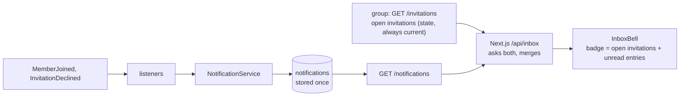

# 3. The inbox module and the bell

One place that tells a person what matters. The new `notification` module is a leaf: it listens to events and nothing depends on it, so later events (payments, waived debts) are one listener each. About 495 lines of backend and 455 of frontend. Commits `aea3375`, `4a360fa`.


Open invitations are asked directly (they are state); entries record what happened (events).

**Start here:** `notification/application/NotificationService.java`, then `InboxBell.tsx`.

| Look at | For |
|---|---|
| `notification/package-info.java` and `ConventionTests` | the leaf rule: nothing may depend on `notification` |
| `NotificationService.java` | writes once per event (the creator's own join is skipped); names are looked up on read, not stored |
| `V501__notifications.sql` | the unique key includes `occurred_at`, so a redelivered event is a no-op but a rejoin still counts |
| `*Listener.java` | thin on purpose: the async listener only calls the service |
| `NotificationController.java` | `limit` 1 to 50 validated here; another person's entry is 404 |
| `app/api/inbox/route.ts` | the one handler without a single backend endpoint; a failed half becomes `null`, a 401 is passed on |
| `InboxBell.tsx` (187 lines) | polls every 30 s, stops after a 401; names rendered as text (no HTML); a failed half shows what loaded |

**Tests:** `NotificationControllerTest` (the real flow with Awaitility), `NotificationEventsTest` (same event twice, rejoin), `InboxBell.test.tsx`; `e2e/mallorca.spec.ts` runs the whole journey.

```sh
D="git diff -w --ignore-cr-at-eol"; PKG=backend/src/main/java/de/hsh/favs/sharewise
$D main...HEAD -- $PKG/notification backend/src/main/resources/db/migration/notification
$D main...HEAD -- frontend/src/components/InboxBell.tsx frontend/src/app/api/inbox
```
