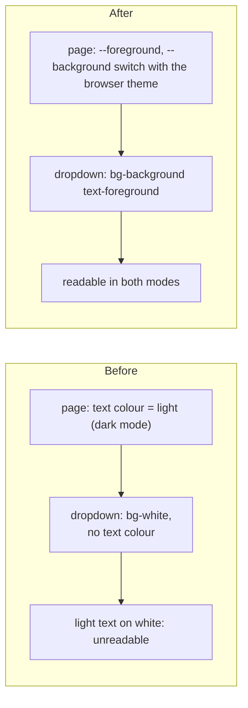
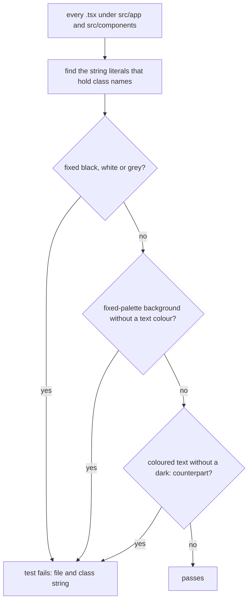

# Feature 4: readable colours in dark mode, and the rule that keeps them so

**Why.** In dark mode the page sets a **light** text colour and every element inherits it. The inbox dropdown had a hard-coded white background and no text colour, so it showed pale text on white. The same pattern was elsewhere in the app. Small in logic, but it touches 13 files.

Commits: `f7de5cb` (the fix), `55d4895` (the rule and its check).

## The failure and the fix



| Was | Now |
|---|---|
| `bg-white` (dropdown, no text colour) | `bg-background text-foreground` |
| `bg-black text-white` buttons | `bg-foreground text-background` (inverts with the theme) |
| `bg-gray-100` badge, inherited text | `bg-foreground/10` |
| `text-gray-600`, `-700`, `-500` | `text-foreground/70`, `/80`, `/60` |
| `border-black` (active tab) | `border-foreground` |
| `text-red-700`, `text-green-700` | plus `dark:text-red-400`, `dark:text-green-400` |
| inputs follow the OS theme | `color-scheme: light dark` in `globals.css` |

## The rule (so it does not come back)

Written in `docs/conventions/04_FRONTEND.md` section 5, "Colours and dark mode", and listed in the enforcement table of `docs/conventions/README.md`. The check is `frontend/src/lib/themeRules.test.ts`:



## What to look at

| File | Look for |
|---|---|
| `frontend/src/lib/themeRules.test.ts` | the three rules, the 8 bad and 9 good samples (the bad ones include the exact old dropdown string), then the scan of the real sources |
| `frontend/src/app/globals.css` | `color-scheme: light dark` |
| `frontend/src/components/InboxBell.tsx`, `MemberList.tsx`, `GroupDetail.tsx` | the three places the problem was visible |
| the other 10 files | one-line class swaps only; skim the diff |

## Diff commands

```sh
D="git diff -w --ignore-cr-at-eol"
git show f7de5cb --stat                       # the 13 files
git show f7de5cb -w --ignore-cr-at-eol        # all the class swaps in one screen
$D main...HEAD -- frontend/src/lib/themeRules.test.ts docs/conventions/04_FRONTEND.md docs/conventions/README.md
```

## Look at it with your own eyes
Switch the browser or OS to dark mode, open the app, and check: the bell dropdown, the Members tab (the Admin badge), the active tab underline, the buttons, error messages. A Playwright run with `colorScheme: "dark"` would automate this (not added).

## Questions to ask yourself
- Is a source scan (class strings) the right strength for this rule, or do you want a screenshot test in dark mode as well?
- The rule is about the fixed palette; is anything left that hard-codes colours outside class strings (inline styles)? (None found.)
