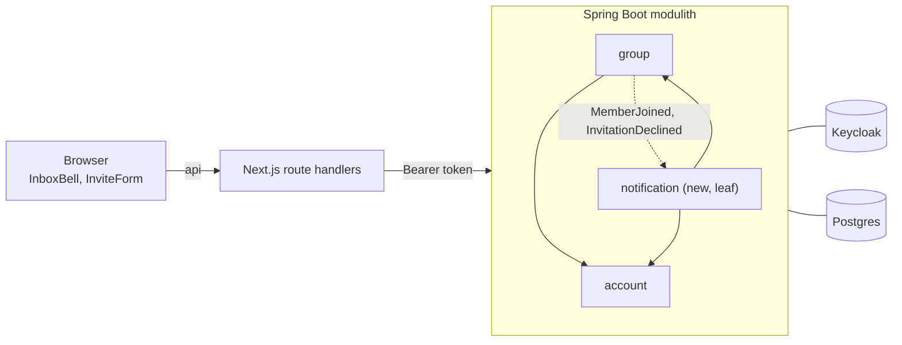
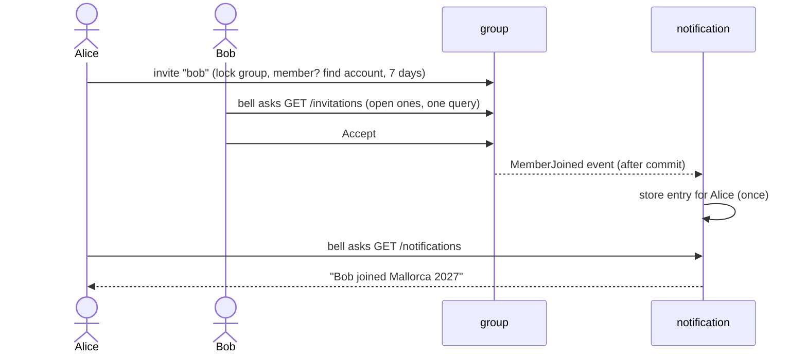

# Reviewing `feature/notifications`

A person is invited to a group by exact username or email, sees the invitation in a bell in the header, and accepts or declines it. The inviter gets an inbox entry for the answer. Along the way: usernames (from Keycloak) and a new leaf module `notification`.

**Start with the feature files, in this order** (each is one short page, backend and frontend together):

| # | File | About |
|---|---|---|
| 1 | [01-usernames.md](01-usernames.md) | usernames and the exact lookup |
| 2 | [02-invitations.md](02-invitations.md) | invitation to an account, decline, "my open invitations" (the rules live here) |
| 3 | [03-notification-inbox.md](03-notification-inbox.md) | the inbox module and the bell |
| 4 | [04-dark-mode-colours.md](04-dark-mode-colours.md) | readable colours in dark mode and its rule |

Decisions and reasons: `docs/2026-11-03-notifications-design.md`, section 3.

## How the parts fit


Arrows point one way: `notification` uses `account` and `group`, nothing uses `notification`.

## The flow in one picture



## Diff commands

```sh
BASE=$(git merge-base main HEAD)
D="git diff -w --ignore-cr-at-eol"      # hides line-ending noise (the repo mixes CRLF and LF)
git log --oneline main..HEAD            # 18 commits, one concern each
git show 13b9c54                        # one commit with its message (the feature files name them)
$D main...HEAD -- docs/api/openapi.yaml # the contract, a good first read
```
Review production code first and the tests of the same feature after; tests are about half of the changed lines.

## Run it
```sh
cd backend  && ./mvnw -q verify     # about 4 min, Docker must run
cd frontend && npm test && npm run e2e
```

## Open points
- Can users rename themselves in the Keycloak account console? (ShareWise copies the username only once; not verified.)
- "No account found" lets any signed-in user probe usernames and emails (your decision: no rate limit).
- With more than 10 unread entries the older ones are not shown in the bell (parked).
