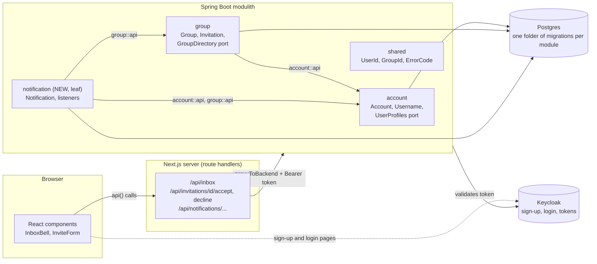
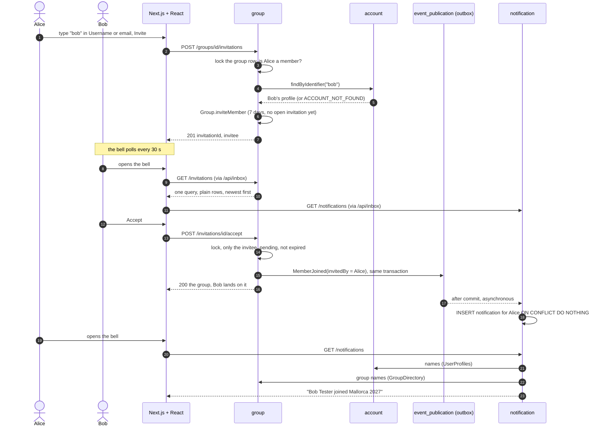

# Reviewing `feature/notifications`

**What the branch does.** A person is invited to a group by exact username or email, finds the invitation in a bell in the header, and accepts or declines it there. The inviter gets an inbox entry for the answer. Along the way accounts got usernames (owned by Keycloak) and a new leaf module `notification` was added.

| File | Feature | Size of the change (without tests) |
|---|---|---|
| [01-usernames.md](01-usernames.md) | usernames from Keycloak, exact lookup | small (backend 117 lines) |
| [02-invitations.md](02-invitations.md) | invitation to an account, decline, "my open invitations" | medium (backend 483 lines) |
| [03-notification-inbox.md](03-notification-inbox.md) | the `notification` module and the bell | largest (backend 495, frontend 455 lines) |
| [04-dark-mode-colours.md](04-dark-mode-colours.md) | readable colours in dark mode and the rule that keeps them so | small, but touches many files |

Design and decisions: `docs/2026-11-03-notifications-design.md` (sections 3, 5, 6 and 9 matter most). Plan: `docs/2026-11-03-notifications.md`.

## 1. Architecture: who talks to whom



Rules to check against this picture:
- **Arrows only point one way.** `notification` depends on `account` and `group`; nothing depends on `notification` (`ConventionTests.nothingDependsOnTheNotificationModule`).
- **Events go the other way.** `group` publishes `MemberJoined` and `InvitationDeclined`; `notification` listens. `group` never calls `notification`.
- **The browser never calls the backend.** Every call goes through a route handler.

## 2. The main data flow: invite, answer, hear about it



## 3. How to review (suggested order, about 90 minutes)

| Step | What | Time | Why this order |
|---|---|---|---|
| 1 | The picture above and design doc section 3 (the decisions) | 10 min | so every later choice has a reason |
| 2 | The contract: `git diff main...HEAD -- docs/api/openapi.yaml` | 10 min | it is the agreement both sides build against |
| 3 | `01-usernames.md`, then `02-invitations.md` (backend) | 30 min | the rules live here |
| 4 | `03-notification-inbox.md` (backend, then frontend) | 30 min | the new module and the bell |
| 5 | `04-dark-mode-colours.md` | 5 min | mostly mechanical |
| 6 | Run the tests (section 5) and click through once | 10 min | seeing it work |

## 4. Diff commands

Run these in the repo root. `-w --ignore-cr-at-eol` hides whitespace and line-ending noise (the repo mixes CRLF and LF).

```sh
# once per shell
BASE=$(git merge-base main HEAD)
PKG=backend/src/main/java/de/hsh/favs/sharewise
TST=backend/src/test/java/de/hsh/favs/sharewise
D="git diff -w --ignore-cr-at-eol"

# the whole branch at a glance
git log --oneline main..HEAD                 # 18 commits, one concern each
$D --stat main...HEAD | tail -1              # totals
$D --stat main...HEAD -- backend/src/main    # only production backend code

# one commit at a time (shows the diff with its message)
git show 169c319        # usernames
git show 13b9c54        # invitations
git show aea3375        # notification module
git show 4a360fa        # frontend
git show 1f8346c        # the projection query that replaced the lazy loading
git show f7de5cb 55d4895   # dark mode fix and its rule

# one feature, all its files (see each feature file for the exact paths)
$D main...HEAD -- $PKG/notification backend/src/main/resources/db/migration/notification

# a file's history on this branch, newest first
git log --oneline main..HEAD -- $PKG/group/domain/Group.java

# side by side: in VS Code use the GitLens command "Compare Working Tree with main"
# (or the built-in "Git: View Changes against Branch"); from the shell:
git difftool -d main...HEAD -- $PKG/group    # needs a configured difftool, e.g. git config --global diff.tool vscode
```

Tip: review production code first (`backend/src/main`, `frontend/src` without tests), then read the tests for the same feature to see which rules are pinned. Tests are about half of the changed lines; they are not the place to start.

## 5. Run it

```sh
cd backend  && ./mvnw -q verify                       # all backend tests (Docker must run), about 4 minutes
cd backend  && ./mvnw -q test -Dtest='GroupTest,InvitationControllerTest,NotificationControllerTest'   # just the three that matter most
cd frontend && npm test                               # 149 unit and component tests
cd frontend && npm run e2e                            # the whole journey in a real browser (backend + Keycloak running)
```

Click-through steps (Alice invites Bob and Carol, they accept and decline): `RUNNING.md`, section "Demo".

## 6. Open points you may want to decide while reviewing

| Point | Where | Status |
|---|---|---|
| Can a user rename themselves in the Keycloak account console? ShareWise copies the username only once. | `docker/keycloak/sharewise-realm.json` | not verified, to check |
| "No account found" lets any signed-in user probe usernames and emails (anyone can create a group). | `GroupService.inviteMember` | accepted, no rate limit (your decision) |
| With more than 10 unread entries the older ones are not shown in the bell. | `InboxBell`, `GET /notifications?limit=10` | parked |
| Payment, waiver and removal entries | wait for `feature/settlements` to be merged | planned |
