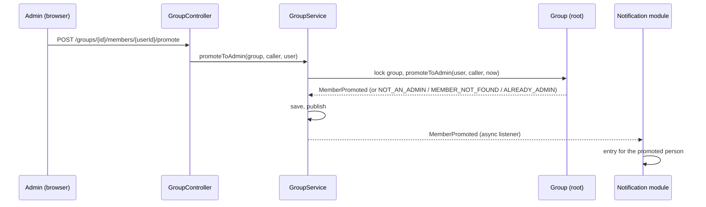

# Review: admin-invites

Branch `feature/admin-invites`. Before: any active member could invite, and nobody could become admin after the group was created. Now: only admins invite (others get 403 and do not see the form), the inviter picks the role, and an admin can promote a member (one way); the promoted person gets an inbox entry. New: `Invitation.role`, event `MemberPromoted`, notification type `MEMBER_PROMOTED`, error codes `NOT_AN_ADMIN`, `MEMBER_NOT_FOUND`, `ALREADY_ADMIN`, migration `V206`.

## Features and where to start

Start at the entry point and follow the path yourself: **controller → service → domain (the rules) → repository**, then the test. Backend paths are under `backend/src/main/java/de/hsh/favs/sharewise/`, frontend under `frontend/src/`.

| Feature | Start at (backend) | Frontend | Test to read |
|---|---|---|---|
| **Invite as admin only, with a role** | `group/web/GroupController.inviteMember` `POST /groups/{groupId}/invitations` → `GroupService.inviteMember` → `Group.requireAdmin`, `Group.inviteMember` | `components/InviteForm.tsx` ("Joins as"), shown by `GroupDetail.tsx` only when `isAdmin` | `InvitationControllerTest`, `GroupTest` |
| **Accept applies the role** | `GroupController.acceptInvitation` → `Group.acceptInvitation` (uses `Invitation.role()`) | `components/InboxBell.tsx` ("as an admin") | `InvitationControllerTest.anInvitationWithRoleAdminMakesTheInviteeAnAdminOnAccepting` |
| **Make a member admin** | `GroupController.promoteToAdmin` `POST /groups/{groupId}/members/{userId}/promote` → `GroupService.promoteToAdmin` → `Group.promoteToAdmin` | `components/MemberList.tsx` ("Make admin") → `app/api/groups/[groupId]/members/[userId]/promote/route.ts` | `GroupControllerTest` (promote tests), `GroupServiceTest` |
| **Promoted person is told** | listener `notification/application/MemberPromotedListener` → `NotificationService.recordMemberPromoted` | `InboxBell.tsx` (`describe`) | `NotificationEventsTest.aPromotionCreatesOneEntry...`, `NotificationControllerTest.aPromotionShowsAPromotedEntry...` |



## Know these before you read

- **Admin-only invites are our choice**, not the professor's: the requirements (J3) say "a member" invites; promotion (J10, R12) is a Must. Say so when defending.
- **Check order is group, caller is admin, then account lookup**, so a non-member learns nothing about which accounts exist.
- **Promotion is one way** (no demotion): nothing in the requirements asks for it, and it avoids a "last admin" rule.
- **The role rides on the invitation** and is applied when the invitee accepts; `MemberInvited` and `MemberJoined` carry it.
- **The UI hiding is only a hint**; the backend 403 is the rule. Promotion is not blocked in closed groups (call).
- Full reasons and history: `docs/specs/2026-11-09-admin-invites/design.md` and `git log`.

## Diff and run

```sh
D="git diff -w --ignore-cr-at-eol"     # hides line-ending noise
$D main...HEAD -- docs/api/openapi.yaml                       # the contract: a good first read
$D main...HEAD -- backend/src/main/java/de/hsh/favs/sharewise/group   # one area at a time
git show 46b7667                       # the group backend commit with its message
cd backend && ./mvnw -q verify      # Docker must run
cd frontend && npm test && npm run build
```

## Open

- `npm run e2e` (Playwright) was not run; the push gate ran backend verify, frontend lint, typecheck, tests, build and contract lint (green).
- Parked review nits: `MemberList` does not reload after a failed promote (409), `InboxBell.describe` falls back to the "declined" text for unknown types, the 403 response block is written twice in `openapi.yaml`, `docs/specs/2026-11-03-notifications/design.md:90` still names `requireActiveMember`.
- Parked until leave/remove exist: the inviter's admin role is not re-checked at accept time.
