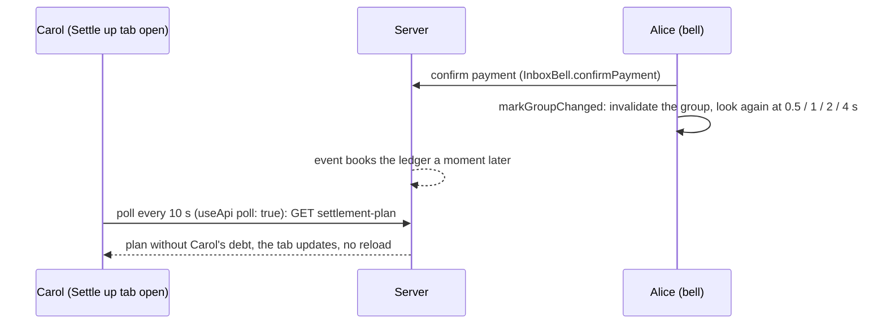

# Review: live-group-views

Branch `feature/live-group-views`. Before: a group screen showed what it loaded when it opened; another member's change (a confirmed payment, a new member, an expense) only appeared after a reload, so the bell and the open tab could contradict each other. Now: the open group page asks again every 10 s and on focus, and two forms no longer change under the user's hands. New: `@tanstack/react-query` (frontend only); no backend, contract or migration change.

## Features and where to start

Frontend only; paths under `frontend/src/`. Start at the component, follow the hook, then read the test.

| Feature | Start at | Then | Test to read |
|---|---|---|---|
| **The open group page refreshes by itself** | `components/GroupDetail.tsx` (`useApi(..., { poll: true })`, the `error && !group` guard) | `lib/useApi.ts` (`POLL_MS`, `queryKeyOf`) → `lib/queryClient.ts` `makeQueryClient` | `GroupDetail.test.tsx` `theOpenGroupPageAsksAgainEveryTenSecondsSoOtherPeoplesChangesShowUp`, `aFailedPollKeepsThePageAndShowsTheBanner` |
| **A write marks its group changed** | `lib/useGroupChange.ts` `markGroupChanged`, `useGroupChange` | callers: `GroupDetail.tsx`, `SettleUpTab.tsx`, `components/InboxBell.tsx` (confirm, reject); the tabs read it: `BalancesTab.tsx`, `SettleUpTab.tsx` `useLookAgain(lastChangedAt, reload)` | `lib/useGroupChange.test.tsx`, `GroupDetail.test.tsx` `afterAnExpenseTheSettleUpTabLooksAgainWhenOpened`, `InboxBell.test.tsx` `answeringAPaymentMarksItsGroupChangedSoOpenTabsLookAgain` |
| **Waiver form keeps its debtor** | `components/WaiveDebtForm.tsx` (`pinned`, `pinShownDebtor`, the select's `disabled`) | – | `WaiveDebtForm.test.tsx` describe `whenThePlanChangesWhileTheFormIsOpen` |
| **Expense form: only me, "Select everyone"** | `components/ExpenseForm.tsx` (`included`) | – | `Expenses.test.tsx` `aMemberWhoJoinsWhileTheFormIsOpenIsNotInTheSplit`, `selectEveryoneTicksAllMembers` |
| **Set-up (touched)** | `components/QueryProvider.tsx` in `app/layout.tsx` | `lib/renderWithQueryClient.tsx` (every component test renders through it) | `lib/useApi.test.tsx` |



## Know these before you read

- **Polling, not a counter.** Another member's change is found by asking again every 10 s; a per-group version counter was designed and parked for the SSE step (same reach, no backend change, none of its race gaps).
- **`staleTime: 0`.** A cached answer is shown at once and asked for again on mount and on focus, so no write has to remember every screen that shows the data.
- **The change time lives in the query cache** as a disabled query that is only ever set; it makes the existing look-again (ledger lag) work on whichever tab opens next.
- **A failed poll keeps the page.** Only a failed first load replaces it; the banner shows above the data. 4xx answers are not retried (`queryClient.ts`).
- **Forms must not follow the plan blindly.** Waiver: once the user chose or typed, the form stays on that debtor, and if he leaves the plan nothing is selected. Expense: only the recorder is ticked at first (R18), so a member who joins meanwhile can never slip into the split.
- **`package-lock.json` was edited by hand** (npm on Windows drops other platforms' entries); only the two `@tanstack` entries were added.
- Full reasons and the failure-mode table: `docs/2026-11-11-live-group-views-design.md`; the plan: `docs/2026-11-11-live-group-views.md`.

## Diff and run

```sh
D="git diff -w --ignore-cr-at-eol"     # hides line-ending noise
$D origin/main...HEAD -- frontend/src/lib                                  # the hooks: a good first read
$D origin/main...HEAD -- frontend/src/components ':!*.test.tsx'            # the components
git show 9f198ae                                                           # "a write marks its group changed"
cd frontend && npm test && npm run e2e   # e2e needs Postgres, Keycloak and the backend (RUNNING.md)
```

## Open

- The bell keeps its own hand-written 30 s poll (not a query); two polling mechanisms to explain.
- A removed member's open page would poll 403 every 10 s; parked until remove/leave have endpoints.
- Light and dark mode of "Select everyone" and the waiver placeholder were not looked at in a browser (theme rules test passes).
- Requirement J4 step 2 was changed in `work/ShareWise_Requirements.md` (FAVS folder, outside this repository).
