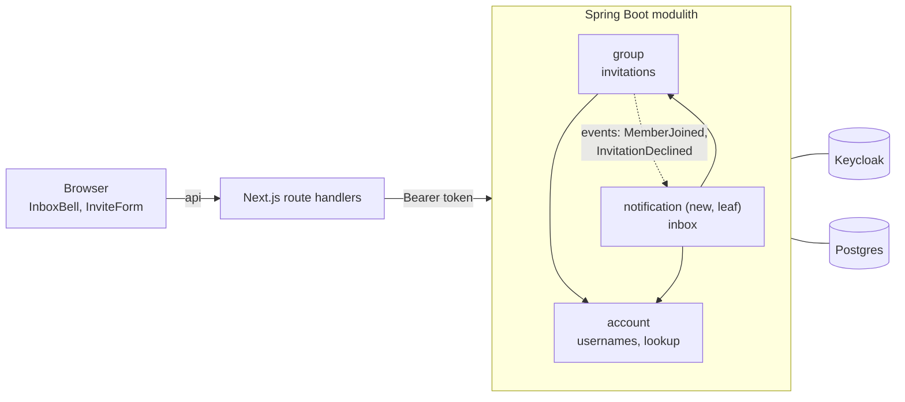
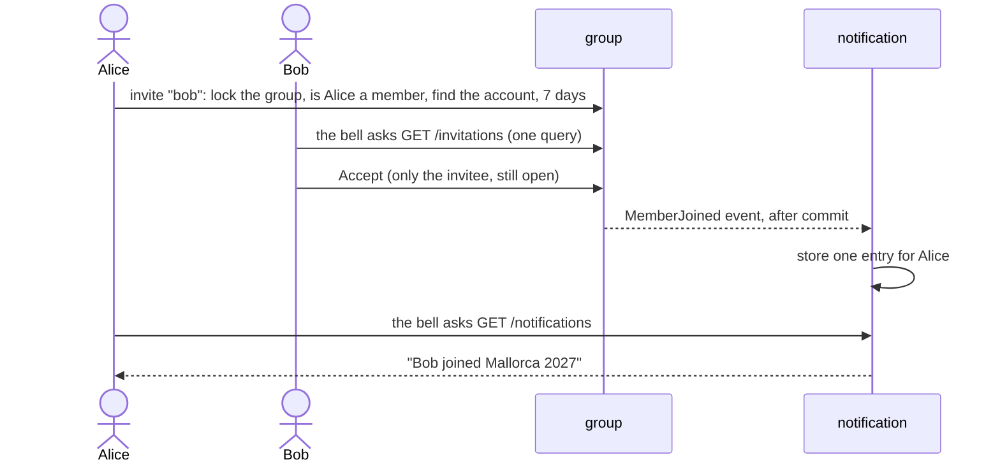

# Review: notifications (usernames, invitations to accounts, inbox)

Branch `feature/notifications`, cut from `main`. Design: `docs/2026-11-03-notifications-design.md`. Plan: `docs/2026-11-03-notifications.md`.
Last verified: full backend suite 250 tests, 0 failures; frontend 149 tests; e2e journey passes against a fresh Keycloak.

**Contents:** 1 Before and now · 2 What was done and why · 3 How it works together · 4 Entry points (how to follow a feature) · 5 Where to start · 6 Decisions · 7 Things that look redundant but are not · 8 Diff commands · 9 Run it · 10 Open and parked

## 1. Before and now

| | Before | Now |
|---|---|---|
| Who can join | anyone holding an invitation **link** | only the **account** that was invited |
| Finding the person | not possible; the inviter shares a link | exact **username or email**; usernames are new (from Keycloak) |
| Seeing an invitation | not inside the app | a **bell** in the header with Accept and Decline |
| Hearing about the answer | no | an **inbox entry** for the inviter ("Bob joined", "Carol declined") |
| Backend | `account`, `group`, `expense`, `settlement` | plus a new leaf module **`notification`** |

## 2. What was done and why

Built in this order (one concern per commit). The "why" is the reason for the step; decisions behind them are in section 6.

| Step | Commits | What | Why |
|---|---|---|---|
| Design, probe, design review | `00f3ea3` `5966251` `3c0a883` `7c5f84f` | design doc, failure modes, an independent review, the plan | find flaws before code: the review turned "invitation as inbox row" into "invitation as a query" |
| Contract | `50cffb3` | `openapi.yaml` alone | one agreement for both sides, committed first |
| Usernames | `169c319` | `Username`, lookup port, realm, migration V106 | invite a known person by a name they can type |
| Invitations | `13b9c54` | invitation to an account, decline, open list, V205 | replace the anyone-with-the-link invite |
| Inbox module | `aea3375` | `notification` module, V501, `GroupDirectory` port | one place for what happened; a leaf so later events are one listener each |
| Frontend | `4a360fa` `1901f5b` | invite box, bell, `/api/inbox`, e2e | the user-visible part |
| First review round | `1be8fbe` `8715b14` `0377fe5` `0073243` | `limit` validated on the controller; conventions (commit scope, aggregating route handler, numbering); restored line endings; stale `/join/` example | request shape is validated at the edge; less diff noise |
| Lazy loading | `1f8346c` | the open-invitations list is one projection query | the old list loaded every matching group and each group's invitations, one extra query per group, on a path polled every 30 s |
| Dark mode | `f7de5cb` `55d4895` | theme tokens instead of fixed colours, plus a test that enforces it | the dropdown had a white background and inherited light text |
| Group cleanup | `a913f47` | `Group.activeMemberships()` is the one "who is in the group" filter; the inviter's membership is checked once, as its own service step | the same filter was written five times, and the membership check ran twice (service and domain) |

**The cleanup `a913f47` in detail** (made in a later session, verified here: 250 tests green):
- `activeMemberships()` is now used by `hasActiveMember`, `memberCount`, `membershipView`, `GroupService.GroupView` and `GroupMembershipImpl.members`. Behaviour is unchanged.
- `Group.inviteMember` no longer calls `requireActiveMember`; `GroupService.inviteMember` does, as step 2, before the account lookup. **Trade-off:** `Group.inviteMember` alone no longer refuses a non-member inviter, so any other caller must check first. Today `GroupService` is the only caller. The order (membership before lookup) stays, so a non-member learns nothing about which accounts exist.
- Tests: `GroupTest.requireActiveMember*` (active passes, non-member refused) and `aFormerMemberIsNeitherActiveNorCountedNorInTheMembershipView`, which sets a member to `FORMER_MEMBER` (that state cannot be produced yet, `leaveGroup` does not exist). `GroupServiceTest.aNonMemberCannotInviteAndLearnsNothingAboutAccounts` and `InvitationControllerTest.postAsNonMemberIs403EvenForAnUnknownIdentifier` still pin the order.

## 3. How it works together


Arrows point one way: `notification` uses `account` and `group`; nothing uses `notification`.


The bell merges two sources through one Next.js handler (`/api/inbox`): **open invitations** are asked from `group` (they are *state*); **entries** come from `notification` (they record what *happened*).

## 4. Entry points: how to follow a feature

Backend entry points are the **controllers** (HTTP) and the **listeners** (events). Layers in every module: `web/` (controller) → `application/` (service, the use case) → `domain/` (the rules) → `persistence/` (repository). Other modules only see a module's `api/`. Frontend entry points are the **pages**; each leads to components, then to a Next.js **route handler**, which proxies to a backend controller. Paths below are relative to `backend/src/main/java/de/hsh/favs/sharewise/` and `frontend/src/`.

### Features at a glance

| Feature | What the user does | Backend entry | Frontend entry |
|---|---|---|---|
| Who am I | signs in, the account is created on first call | `account/web/AccountController` `GET /me` | `app/login/page.tsx`, `app/api/auth/*`, `lib/currentUser.tsx` |
| Groups | creates a group, lists theirs, opens one | `group/web/GroupController` `POST/GET /groups`, `GET /groups/{id}` | `app/page.tsx`, `app/groups/new`, `app/groups/[id]` |
| **Invitations** | invites an account, answers an invitation | `GroupController` `POST /groups/{id}/invitations`, `GET /invitations`, `POST /invitations/{id}/accept\|decline` | `InviteForm`, `InboxBell` |
| Expenses | records an expense, sees the list | `expense/web/ExpenseController` `POST/GET /groups/{id}/expenses` | `ExpenseForm`, `ExpenseList` |
| Balances | sees who owes what | `settlement/web/BalanceController` `GET /groups/{id}/balances` | `BalancesTab` |
| **Inbox** | sees invitations and "Bob joined" entries | `notification/web/NotificationController` `GET /notifications`, `POST .../read`, `POST /notifications/read-all`, plus `GET /invitations` | `InboxBell`, `app/api/inbox/route.ts` |

Bold = what this branch is about. The other rows are existing features that the new ones touch.

### Backend: controllers

| Controller | Endpoint | Calls | Rules live in |
|---|---|---|---|
| `AccountController` | `GET /me` | `CurrentUser` | `account/application/AccountService` |
| `GroupController` | `POST /groups` | `GroupService.createGroup` | `Group.createGroup` |
| | `GET /groups` | `GroupService.listGroups` → `GroupRepository.findAllByActiveMember` | none, a read |
| | `GET /groups/{id}` | `GroupService.getGroup` | `GroupMembership.requireMember` |
| | `POST /groups/{id}/invitations` | `GroupService.inviteMember` | `Group.requireActiveMember`, `Group.inviteMember` |
| | `GET /invitations` | `GroupService.listPendingInvitations` → `GroupRepository.findPendingInvitationsFor` | the query repeats `Invitation.statusAt` |
| | `POST /invitations/{id}/accept` | `GroupService.acceptInvitation` | `Group.acceptInvitation`, `Invitation.requireAnswerableBy` |
| | `POST /invitations/{id}/decline` | `GroupService.declineInvitation` | `Group.declineInvitation`, `Invitation.requireAnswerableBy` |
| `ExpenseController` | `POST /groups/{id}/expenses` | `ExpenseService.recordExpense` | `Expense` (group open, payer and participants are active members) |
| | `GET /groups/{id}/expenses` | `ExpenseService.listExpenses` | membership check |
| `BalanceController` | `GET /groups/{id}/balances` | `membership.requireMember`, then `Balances.of` | ledger read; names from `UserProfiles` |
| `NotificationController` | `GET /notifications` | `NotificationService.list` | none, a read |
| | `POST /notifications/{id}/read` | `NotificationService.markRead` | `Notification.markRead` (idempotent) |
| | `POST /notifications/read-all` | `NotificationService.markAllRead` | one update query |

### Backend: listeners (asynchronous, after the commit)

| Listener | Reacts to | Does | Raised by |
|---|---|---|---|
| `notification/application/MemberJoinedListener` | `MemberJoined` | `NotificationService.recordMemberJoined`: an entry for the inviter (none for the creator) | `GroupService.createGroup`, `GroupService.acceptInvitation` |
| `notification/application/InvitationDeclinedListener` | `InvitationDeclined` | `NotificationService.recordInvitationDeclined`: an entry for the inviter | `GroupService.declineInvitation` |
| `settlement/application/ExpenseRecordedListener` | `ExpenseRecorded` | `GroupLedgerService.bookExpense`: updates the balances | `ExpenseService.recordExpense` |

Listeners are thin on purpose; the logic is in the service they call, so tests call the service directly.

### Paths to follow (backend, controller first)

**A. Invite someone** (the write path with the most rules)
1. `GroupController.inviteMember`
2. `GroupService.inviteMember`, in this order: (1) `lockedGroup`: `SELECT … FOR UPDATE` on the group row, so two invites cannot run side by side; (2) `Group.requireActiveMember(inviter)`: `NOT_A_MEMBER`, **before** the lookup; (3) `UserProfiles.findByIdentifier`: username or email, active accounts only, else `ACCOUNT_NOT_FOUND`; (4) `Group.inviteMember`: `ALREADY_MEMBER`, `ALREADY_INVITED`, then `Invitation.issue` (7 days); (5) publish `MemberInvited`
3. Tests: `GroupTest`, `GroupServiceTest`, `InvitationControllerTest`

**B. Answer an invitation**
1. `GroupController.acceptInvitation` or `declineInvitation`
2. `GroupService.lockedGroupOfInvitation`: find the group by invitation id, then lock it
3. `Group.acceptInvitation` / `declineInvitation` → `Invitation.requireAnswerableBy`: somebody else's or an answered invitation is `INVITATION_NOT_FOUND`; older than 7 days is `INVITATION_EXPIRED`
4. accept also checks `ALREADY_MEMBER`, then adds the `Membership`; the event goes out and the listener writes the inviter's entry

**C. The inbox**
1. `GET /invitations` (open invitations, state) and `GET /notifications` (what happened, entries) are two sources
2. `app/api/inbox/route.ts` calls both and merges them for the bell
3. an entry is created only by the two group listeners above

**D. Record an expense and see the balance** (existing, for context): `ExpenseController` → `ExpenseService.recordExpense` → `Expense` → publish `ExpenseRecorded` → `ExpenseRecordedListener` → `GroupLedgerService.bookExpense`; `BalanceController.getBalances` reads the ledger.

### Frontend: pages

| URL | File | Renders |
|---|---|---|
| `/` | `app/page.tsx` | `GroupList` |
| `/login` | `app/login/page.tsx` | link to `/api/auth/login` (Keycloak) |
| `/groups/new` | `app/groups/new/page.tsx` | `CreateGroupForm` |
| `/groups/[id]` | `app/groups/[id]/page.tsx` | `GroupDetail`: tabs for expenses, balances, members |
| every page | `app/layout.tsx` | `CurrentUserProvider`, header with `AuthBar` → `InboxBell` |

### Frontend: component → route handler → backend

The browser never calls the backend. Components call `lib/api.ts` (`/api/...`); a route handler in `app/api/` calls `proxyToBackend` (`lib/backend.ts`), which adds the Bearer token from the session cookie.

| Component | Browser call | Route handler (`app/api/...`) | Backend endpoint |
|---|---|---|---|
| `lib/currentUser.tsx` | `GET /api/me` | `me/route.ts` | `GET /me` |
| `GroupList` / `CreateGroupForm` | `GET`, `POST /api/groups` | `groups/route.ts` | `GET`, `POST /groups` |
| `GroupDetail` | `GET /api/groups/{id}` | `groups/[groupId]/route.ts` | `GET /groups/{id}` |
| `GroupDetail` / `ExpenseForm` | `GET`, `POST /api/groups/{id}/expenses` | `groups/[groupId]/expenses/route.ts` | `GET`, `POST /groups/{id}/expenses` |
| `BalancesTab` | `GET /api/groups/{id}/balances` | `groups/[groupId]/balances/route.ts` | `GET /groups/{id}/balances` |
| **`InviteForm`** | `POST /api/groups/{id}/invitations` | `groups/[groupId]/invitations/route.ts` | `POST /groups/{id}/invitations` |
| **`InboxBell`** (poll) | `GET /api/inbox` | `inbox/route.ts` (merges two calls) | `GET /invitations` + `GET /notifications?limit=10` |
| **`InboxBell`** accept / decline | `POST /api/invitations/{id}/accept\|decline` | `invitations/[invitationId]/*/route.ts` | same paths |
| **`InboxBell`** read | `POST /api/notifications/{id}/read`, `/read-all` | `notifications/**/route.ts` | same paths |
| `AuthBar` | `POST /api/auth/logout` | `auth/logout/route.ts` | none (clears the session) |

Shared plumbing, read once: `lib/api.ts` (browser `fetch` wrapper, throws `ApiError`), `lib/backend.ts` (server-side proxy, token refresh), `lib/session.ts` and `lib/oidc.ts` (login session), `api/schema.d.ts` (generated from the contract, never edit by hand).

## 5. Where to start

Read production code first, tests after. About 1,150 lines of backend and 450 of frontend production code; tests are about half of the changed lines.

| # | Read | Why first |
|---|---|---|
| 1 | `git diff main...HEAD -- docs/api/openapi.yaml` | the contract both sides build against: new endpoints and error codes |
| 2 | **Path A and B from section 4:** `Invitation.java` (76 lines), `Group.java`, `GroupService.java` | expiry, who may answer, the lock, the order of checks |
| 3 | **Usernames:** `account/domain/Username.java`, `AccountService.java`, `UserProfilesImpl.java` | the `@` rule and the exact lookup |
| 4 | **Path C:** `notification/application/NotificationService.java`, `V501__notifications.sql`, the two `*Listener` classes | idempotent entries; thin async listeners |
| 5 | **Frontend:** `components/InboxBell.tsx` (187 lines), `app/api/inbox/route.ts`, `components/InviteForm.tsx` | the bell, polling, the merge of two sources |
| 6 | Migrations and realm: `V106`, `V205`, `V501`, `docker/keycloak/sharewise-realm.json` | schema and sign-up rules |
| 7 | Tests of what you read: `GroupTest`, `InvitationControllerTest`, `NotificationControllerTest`, `InboxBell.test.tsx`, `e2e/mallorca.spec.ts` | the rules pinned |

For each path: controller → service → domain → repository, then the test of the same name, then the matching frontend row in section 4. Dark mode (`f7de5cb`, `55d4895`) is mostly one-line class swaps; start from `frontend/src/lib/themeRules.test.ts`.

## 6. Important decisions (and why)

| Decision | Why | See |
|---|---|---|
| `notification` is its own **leaf** module | payment entries come from `settlement`, which already depends on `group`; entries inside `group` would force `group → settlement`, a cycle | `ConventionTests.nothingDependsOnTheNotificationModule` |
| A received invitation is **state, not an event**: asked from `group`, not stored as an inbox row | a stored copy goes stale and a failed listener could hide an invitation for days (design review) | `GET /invitations`, `GroupRepository.findPendingInvitationsFor` |
| `EXPIRED` is **derived**, never stored; no unique index; the **group row lock** is the single guard | an index sees only the stored status, so expired-but-untouched invitations would block re-inviting forever | `Invitation.statusAt`, `V205` |
| The inviter's membership is checked **once, as its own service step, before** the account lookup | a non-member must learn nothing about who has an account; one check instead of two | `GroupService.inviteMember`, `a913f47` |
| Someone else's or an answered invitation is `INVITATION_NOT_FOUND` | ids cannot be probed | `Invitation.requireAnswerableBy` |
| Usernames come from **Keycloak**, lower case, **never contain `@`** | the lookup tells email from username by the `@`; otherwise `bob@x.de` as a username could catch the real Bob's invitations | `Username`, realm file |
| `Username` is a domain value object, not a controller annotation | the username never arrives through one of our endpoints (it comes from the token), and the invariant must hold on every path that creates an account | `Username` |
| No legacy handling: the dev database is recreated | simpler than a backfill for a study project | `V106`, `RUNNING.md` |
| The inbox stores **ids only**; names are looked up on read | names change; events carry ids so they can become messages later | `Notification`, `GroupDirectory` |
| Unique key of an entry includes `occurred_at` | a redelivered event is a no-op, a person who leaves and rejoins still counts | `V501` |
| Listener logic lives in the service | `@ApplicationModuleListener` is asynchronous; tests call the service directly | `NotificationService`, `NotificationEventsTest` |
| "No account found" is shown, **no rate limit** | your decision (note: anyone can create a group, so "only members can ask" is a weak limit) | design N11 |
| Migration `V205`, not `V204` | `feature/settlements` already owns group `V204`; two files with one version stop Flyway after the merge | `V205` |
| Contract first and alone; the link flow removed | one agreement for both sides | `50cffb3` |
| Dark mode rule enforced by a test | the same mistake was in 13 places | `themeRules.test.ts` |

## 7. Things that look redundant but are not

Answers to questions that came up while reading the code.

| It looks like | Why it is needed |
|---|---|
| "Pending" is checked in many places | Three different jobs. `Invitation.statusAt(now)` derives `EXPIRED` (never stored). `Group.pendingInvitationsFor` is used only for `ALREADY_INVITED` in `inviteMember`. `GroupRepository.findPendingInvitationsFor` is used only by `GET /invitations` (the list). Invite, accept and decline do **not** go through that query; they load one group by id, so each checks the state itself, and the state can change between listing and clicking. |
| The SQL query repeats the `statusAt` rule | On purpose, so a list does not load whole groups. Pinned at the boundary by `GroupTest.anInvitationIsStillOpenAtTheExactExpiryInstant` and `InvitationControllerTest.anInvitationExactlyAtItsExpiryInstantIsStillListed`. |
| `findByIdentifier` filters inactive accounts, `find` and `findProfiles` do not | Deliberate: an inactive account cannot be invited, but its name must still show on old data. Pinned by `UserProfilesImplTest.anInactiveAccountIsNotFound`. `findByIdentifier` is null-safe (a null identifier becomes empty). |
| Two lock-related methods in `GroupService` | One lock method, `lockedGroup`; `lockedGroupOfInvitation` only finds the group id from an invitation id and then calls it. |
| `acceptInvitation` and `declineInvitation` call `saveAndFlush`, `inviteMember` does not | Harmless: inside the transaction the loaded group is managed, so the new invitation is written at commit. Not unified; a later tidy-up if you prefer symmetry. |
| `Notification.markRead` checks `readAt == null` | Idempotent: reading twice keeps the first time. |
| `GET /groups` is a service method with no rules | It backs the group list page: a plain read. |

Possible small simplification, not done: `Invitation.requireAnswerableBy` looks at the stored status and then at `statusAt`; it could use `statusAt` alone. Behaviour would be the same.

## 8. Diff commands

```sh
D="git diff -w --ignore-cr-at-eol"      # hides line-ending noise (the repo mixes CRLF and LF)
PKG=backend/src/main/java/de/hsh/favs/sharewise
git log --oneline main..HEAD            # one concern per commit
git show a913f47                        # one commit with its message
$D main...HEAD --stat | tail -1         # totals

$D main...HEAD -- docs/api/openapi.yaml                                              # contract
$D main...HEAD -- $PKG/group backend/src/main/resources/db/migration/group           # invitations
$D main...HEAD -- $PKG/account backend/src/main/resources/db/migration/account docker/keycloak   # usernames
$D main...HEAD -- $PKG/notification backend/src/main/resources/db/migration/notification        # inbox
$D main...HEAD -- frontend/src/components/InboxBell.tsx frontend/src/components/InviteForm.tsx frontend/src/app/api
```
In VS Code with GitLens: **Search & Compare → Compare References** (`main` vs `feature/notifications`, working tree included) gives all files together; open the right-hand file from the diff for navigation (needs the Extension Pack for Java).

## 9. Run it

```sh
cd backend  && ./mvnw -q verify     # about 4 minutes, Docker must run
cd frontend && npm test && npm run e2e
```
Click-through: `RUNNING.md`, "Demo". After the username change delete old local data once: `docker compose down -v`.

## 10. Open and parked

- Can users rename themselves in the Keycloak account console? ShareWise copies the username only once. Not verified.
- With more than 10 unread entries the older ones are not shown in the bell.
- Inviting to a closed group and re-inviting a former member cannot happen until `closeForSettlement`, `leaveGroup` and `removeMember` exist.
- Payment, waiver and removal entries wait for `feature/settlements` to be merged.
- `build/` (generated Spring Modulith output) appears untracked in the repo root; it is ignored by `.gitignore` from now on.
