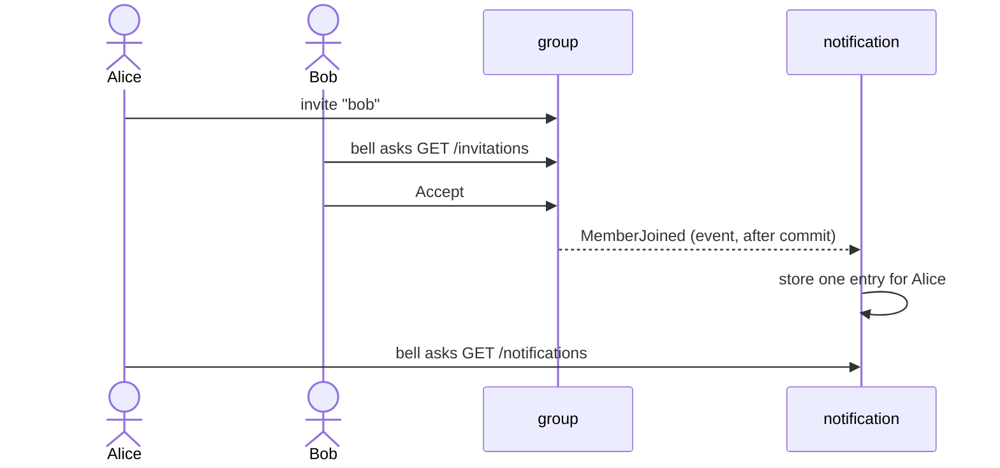

# Review: notifications

Branch `feature/notifications`. Before: a group invited by **link**, anyone with the link joined, nobody saw anything in the app. Now: you invite an **existing account** by username or email, the person sees it in a **bell** and accepts or declines, and the inviter gets an **inbox entry**. New: usernames (from Keycloak) and a leaf module `notification`.

## Features and where to start

Start at the entry point and follow the path yourself: **controller → service → domain (the rules) → repository**, then the test. Backend paths are under `backend/src/main/java/de/hsh/favs/sharewise/`, frontend under `frontend/src/`.

| Feature | Start at (backend) | Frontend | Test to read |
|---|---|---|---|
| **Sign up with a username** | `account/web/AccountController` `GET /me` → `AccountService.resolveOrCreate` → `domain/Username` | Keycloak's own page | `UsernameTest`, `AccountServiceTest` |
| **Find a person** (by username or email) | `UserProfiles.findByIdentifier` in `account/application/UserProfilesImpl` | – | `UserProfilesImplTest` |
| **Invite a person** | `group/web/GroupController.inviteMember` `POST /groups/{id}/invitations` → `GroupService.inviteMember` → `Group.inviteMember` | `components/InviteForm.tsx` | `GroupTest`, `InvitationControllerTest` |
| **See my open invitations** | `GroupController.listPendingInvitations` `GET /invitations` → `GroupRepository.findPendingInvitationsFor` | `components/InboxBell.tsx` (via `app/api/inbox/route.ts`) | `InvitationControllerTest` |
| **Accept an invitation** | `GroupController.acceptInvitation` → `GroupService.acceptInvitation` → `Group.acceptInvitation` → `Invitation.requireAnswerableBy` | `InboxBell.tsx` (Accept) | `GroupTest`, `InvitationControllerTest` |
| **Decline an invitation** | `GroupController.declineInvitation` → `Group.declineInvitation` | `InboxBell.tsx` (Decline) | same |
| **Hear about the answer** (inbox entry) | `notification/application/NotificationListener` (`on(MemberJoined)`, `on(InvitationDeclined)`) → `NotificationService.record…` | – | `NotificationEventsTest` |
| **Read the inbox** | `notification/web/NotificationController` `GET /notifications`, `POST …/read`, `…/read-all` | `InboxBell.tsx` | `NotificationControllerTest`, `InboxBell.test.tsx` |
| **Readable in dark mode** | – | class swaps in 13 files | `lib/themeRules.test.ts` |

Backend entry points are **controllers** (HTTP) and **listeners** (events). Frontend entry points are components; each calls a Next.js route handler in `app/api/`, which forwards to the backend controller.



## Know these before you read

- **Invitation = state, not an event.** The bell asks `group` for open invitations; the inbox only holds *what happened*. (A stored copy goes stale, and a failed listener could hide an invitation.)
- **Expiry is derived** (`Invitation.statusAt`), never stored, so there is **no unique index**; the **group row lock** (`lockedGroup`) keeps one open invitation per person.
- **Order in `GroupService.inviteMember`:** lock → is the inviter a member → find the account → invite. Membership comes before the lookup so a non-member learns nothing about who has an account.
- **`Username` never contains `@`** (the lookup tells email from username by it) and is checked in the domain, because the name comes from the Keycloak token, not from our own endpoint.
- **`notification` is a leaf:** it uses `account` and `group`, nothing uses it. It stores ids only; names are looked up on read.
- Full reasons and the review history: `docs/2026-11-03-notifications-design.md` (section 3) and `git log`.

## Diff and run

```sh
D="git diff -w --ignore-cr-at-eol"     # hides line-ending noise
$D main...HEAD -- docs/api/openapi.yaml                       # the contract: a good first read
$D main...HEAD -- backend/src/main/java/de/hsh/favs/sharewise/group   # one area at a time
git show <commit>                                             # one commit with its message
cd backend && ./mvnw -q verify      # ~4 min, Docker must run
cd frontend && npm test && npm run e2e
```

## Open

- Can users rename themselves in the Keycloak account console? (ShareWise copies the username only once; not verified.)
- With more than 10 unread entries the older ones are not shown in the bell.
