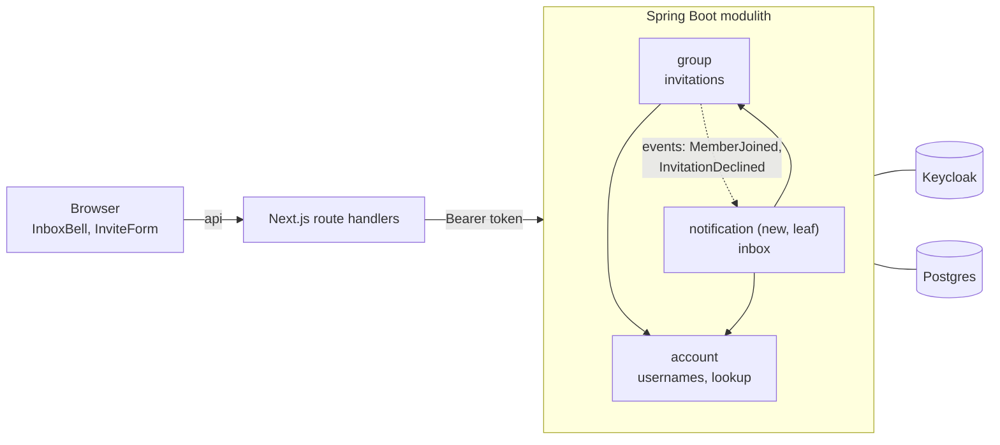
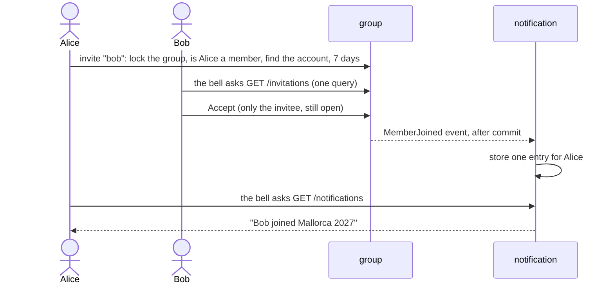

# Review: notifications (usernames, invitations to accounts, inbox)

Branch `feature/notifications`, 18 commits, cut from `main`. Design: `docs/2026-11-03-notifications-design.md`. Plan: `docs/2026-11-03-notifications.md`.

## 1. Before and now

| | Before | Now |
|---|---|---|
| Who can join | anyone holding an invitation **link** | only the **account** that was invited |
| Finding the person | not possible; the inviter shares a link | exact **username or email**; usernames are new (from Keycloak) |
| Seeing an invitation | not inside the app | a **bell** in the header with Accept and Decline |
| Hearing about the answer | no | an **inbox entry** for the inviter ("Bob joined", "Carol declined") |
| Backend | `account`, `group`, `expense`, `settlement` | plus a new leaf module **`notification`** |

## 2. How it works together


Arrows point one way: `notification` uses `account` and `group`; nothing uses `notification`.


The bell merges two sources through one Next.js handler (`/api/inbox`): **open invitations** are asked from `group` (they are *state*); **entries** come from `notification` (they record what *happened*).

## 3. Where to start

Read production code first, tests after. About 1,150 lines of backend and 450 of frontend production code; tests are about half of the changed lines.

| # | Read | Why first |
|---|---|---|
| 1 | `git diff main...HEAD -- docs/api/openapi.yaml` | the contract both sides build against: the new endpoints and error codes |
| 2 | **Backend, the rules:** `group/domain/Invitation.java` (76 lines), `Group.java`, `GroupService.java` | expiry, who may answer, the lock, the order of checks |
| 3 | **Backend, usernames:** `account/domain/Username.java`, `AccountService.java`, `UserProfilesImpl.java` | the `@` rule and the exact lookup |
| 4 | **Backend, the new module:** `notification/application/NotificationService.java`, `V501__notifications.sql`, the two `*Listener` classes | idempotent entries; thin async listeners |
| 5 | **Frontend:** `components/InboxBell.tsx` (187 lines), `app/api/inbox/route.ts`, `components/InviteForm.tsx` | the bell, polling, the merge of two sources |
| 6 | Migrations and realm: `V106`, `V205`, `V501`, `docker/keycloak/sharewise-realm.json` | schema and sign-up rules |
| 7 | Tests of what you read: `GroupTest`, `InvitationControllerTest`, `NotificationControllerTest`, `InboxBell.test.tsx`, `e2e/mallorca.spec.ts` | the rules pinned |

Smaller, mostly mechanical: dark-mode colour fixes in 13 files (`f7de5cb`) and the rule that keeps them (`themeRules.test.ts`, `55d4895`).

## 4. Important decisions (and why)

| Decision | Why | See |
|---|---|---|
| `notification` is its own **leaf** module | payment entries come from `settlement`, which already depends on `group`; entries inside `group` would force `group → settlement`, a cycle | `ConventionTests.nothingDependsOnTheNotificationModule` |
| A received invitation is **state, not an event**: asked from `group`, not stored as an inbox row | a stored copy goes stale and a failed listener could hide an invitation for days (found by the design review) | `GET /invitations`, `GroupRepository.findPendingInvitationsFor` |
| `EXPIRED` is **derived**, never stored; no unique index; the **group row lock** is the single guard | an index can only see the stored status, so expired-but-untouched invitations would block re-inviting forever | `Invitation.statusAt`, `V205` |
| Membership is checked **before** the account lookup | a non-member must learn nothing about who has an account | `GroupService.inviteMember` |
| Someone else's or an answered invitation is `INVITATION_NOT_FOUND` | ids cannot be probed | `Invitation.requireAnswerableBy` |
| Usernames come from **Keycloak**, lower case, **never contain `@`** | the lookup tells email from username by the `@`; otherwise `bob@x.de` as a username could catch the real Bob's invitations | `Username`, realm file |
| No legacy handling: the dev database is recreated | simpler than a backfill for a study project | `V106`, `RUNNING.md` |
| The inbox stores **ids only**; names are looked up on read | names change; events carry ids so they can become messages later | `Notification`, `GroupDirectory` port |
| Unique key of an entry includes `occurred_at` | a redelivered event is a no-op, a person who leaves and rejoins still counts | `V501` |
| Listener logic lives in the service | `@ApplicationModuleListener` is asynchronous; tests call the service directly | `NotificationService`, `NotificationEventsTest` |
| "No account found" is shown, **no rate limit** | your decision (note: anyone can create a group, so "only members can ask" is a weak limit) | design N11 |
| Migration `V205`, not `V204` | `feature/settlements` already owns group `V204`; two files with one version stop Flyway after the merge | `V205` |
| Contract first and alone; the link flow removed | one agreement for both sides | `50cffb3` |
| Dark mode rule enforced by a test | the same mistake was in 13 places | `themeRules.test.ts` |

## 5. Diff commands

```sh
D="git diff -w --ignore-cr-at-eol"      # hides line-ending noise (the repo mixes CRLF and LF)
PKG=backend/src/main/java/de/hsh/favs/sharewise
git log --oneline main..HEAD            # one concern per commit
git show 13b9c54                        # one commit with its message
$D main...HEAD --stat | tail -1         # totals

$D main...HEAD -- docs/api/openapi.yaml                                              # contract
$D main...HEAD -- $PKG/group backend/src/main/resources/db/migration/group           # invitations
$D main...HEAD -- $PKG/account backend/src/main/resources/db/migration/account docker/keycloak   # usernames
$D main...HEAD -- $PKG/notification backend/src/main/resources/db/migration/notification        # inbox
$D main...HEAD -- frontend/src/components/InboxBell.tsx frontend/src/components/InviteForm.tsx frontend/src/app/api
```
Key commits: `169c319` usernames · `13b9c54` invitations · `aea3375` notification module · `4a360fa` frontend · `1f8346c` projection query (no lazy loading) · `f7de5cb`, `55d4895` dark mode.

## 6. Run it

```sh
cd backend  && ./mvnw -q verify     # about 4 minutes, Docker must run
cd frontend && npm test && npm run e2e
```
Click-through: `RUNNING.md`, "Demo". After the username change delete old local data once: `docker compose down -v`.

## 7. Open and parked

- Can users rename themselves in the Keycloak account console? ShareWise copies the username only once. Not verified.
- With more than 10 unread entries the older ones are not shown in the bell.
- Inviting to a closed group and re-inviting a former member cannot happen until `closeForSettlement`, `leaveGroup` and `removeMember` exist.
- Payment, waiver and removal entries wait for `feature/settlements` to be merged.
