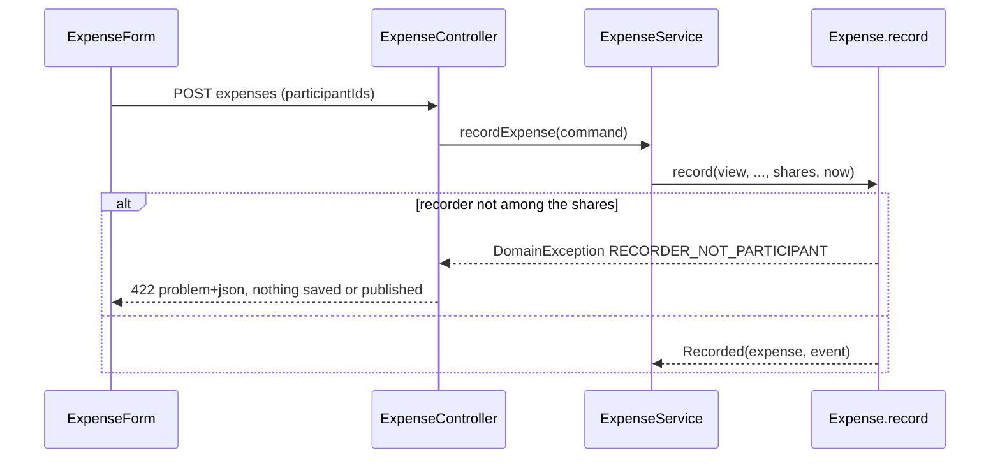

# Review: the recorder stays a participant

Branch `fix/recorder-stays-participant`. Before: the person recording an expense could untick themselves in "Split equally between", and `Expense.record` had no rule about it. Now: the recorder is always a participant (R18); the form locks their checkbox and the domain refuses anything else with `RECORDER_NOT_PARTICIPANT` (422). New: one `ErrorCode`, nothing else (no module, table or event).

## Features and where to start

Start at the entry point and follow the path yourself: **controller → service → domain (the rules)**, then the test. Backend paths are under `backend/src/main/java/de/hsh/favs/sharewise/`, frontend under `frontend/src/`.

| Feature | Start at (backend) | Frontend | Test to read |
|---|---|---|---|
| **Record an expense; the recorder must take part** | `expense/web/ExpenseController.recordExpense` `POST /groups/{groupId}/expenses` → `ExpenseService.recordExpense` → `Expense.record` (the R18 check after the participant loop) | `components/ExpenseForm.tsx` (own checkbox `disabled`), `lib/errors.ts` | `ExpenseTest.theRecorderMustBeOneOfTheParticipants`, `ExpenseControllerTest.aRecorderWhoIsNotAParticipantIs422AndNothingIsRecorded` |
| **The form cannot drop the recorder** | – | `components/ExpenseForm.tsx` → `POST /api/groups/[groupId]/expenses` (route handler, unchanged) | `Expenses.test.tsx` `theRecorderCannotUntickThemselvesButOthersCanBeUnticked`, `errors.test.ts` |



## Know these before you read

- **Recorder only, not the payer.** The user asked for the recorder; R3 stays "the payer may or may not take part". Alice cannot record "I paid for Bob and Carol" for herself; Bob records it with Alice as `paidBy`.
- **Enforced twice on purpose.** The disabled checkbox is a convenience; any direct API call would bypass it, so the aggregate holds the rule (conventions 01, 2.3).
- **Check order.** The new check sits after the participant checks and before the amount check, so the earlier error codes are unchanged.
- **Only existing test touched for the rule:** `thePayerNeedNotTakePartInTheSplit` (Bob records it now); two other domain tests use Alice as the only share holder.
- **Full reasons:** `docs/specs/2026-11-09-recorder-stays-participant/design.md` and `git log`.

## Diff and run

```sh
D="git diff -w --ignore-cr-at-eol"     # hides line-ending noise
$D main...HEAD -- docs/api/openapi.yaml                                  # the contract: a good first read
$D main...HEAD -- backend/src/main/java/de/hsh/favs/sharewise/expense   # the rule
git show fcead01                                                         # the domain commit
cd backend && ./mvnw -q verify      # Docker must run
cd frontend && npm test
```

## Open

- The `recordExpense` 422 example `detail` in `openapi.yaml` is worded slightly differently from the backend message (cosmetic, would need its own `contract` commit).
- `correct` does not exist yet; decide then whether R18 applies to the corrector.
- Not verified in a browser or by Playwright (`npm run e2e` was not run).
