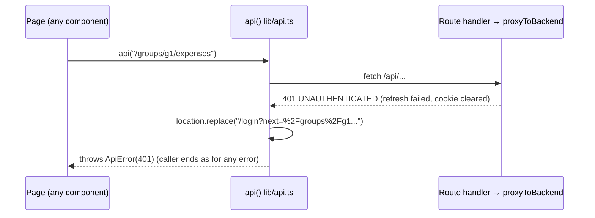

# Review: session-redirect

Branch `fix/session-redirect`. Before: only the first `/me` call of a page sent a signed-out visitor to sign in; a session lost later left the page with the banner "You are not signed in. Please sign in." and no way on. Now: any 401 from any browser call sends the visitor to `/login?next=<this page>` and back after signing in. New: no module, table or endpoint; the rule moves into `api()`.

## Features and where to start

Frontend only; paths under `frontend/src/`. The backend is unchanged.

| Feature | Start at | Then | Test to read |
|---|---|---|---|
| **Any call gets a 401 → sign in and back** | `lib/api.ts` `api()` (the `res.status === 401` branch) | `app/login/page.tsx` reads `next` through `safeReturnTo` (`lib/session.ts`) | `lib/api.test.ts` `aRejectedSessionSendsTheVisitorToSignInAndBackToThisPage` |
| **Other errors stay on the page** | same branch, not taken | `ErrorBanner` + `messageFor` as before | `otherErrorsDoNotNavigate`, `throwsApiErrorWithCodeFromProblemJson`, `throwsApiErrorWhenNetworkFailsAndDoesNotNavigate` |
| **Who am I (touched)** | `lib/currentUser.tsx` `CurrentUserProvider`: own redirect removed | `components/AuthBar.tsx` | `lib/currentUser.test.tsx` `doesNotAskOnThePublicPage` |
| **The bell (touched)** | `components/InboxBell.tsx` `load`: `stopped` ref removed | – | `components/InboxBell.test.tsx` (`stopsPollingAfter401` removed) |



## Know these before you read

- **One place, still throws.** The redirect lives only in `api()`; it still throws so callers need no 401 branch (`03` section 7, one place per rule).
- **No "first 401 only" flag (S3 dropped).** Several 401s all `replace` to the same address; the browser lands once, no history entry is added.
- **No `/login` guard in `api()` (S4 dropped).** Nothing on `/login` calls `api()`; `PUBLIC_PATHS` stays in `currentUser.tsx`. Parked trigger: a backend call on the sign-in page.
- **`next` is not checked where it is written.** It is our own location; the reader (`login/page.tsx`) checks it with `safeReturnTo`, a server module.
- **The banner flashes briefly** while the browser leaves; accepted, as is losing an unsent form after a week-old session.
- Full reasons: `docs/specs/2026-11-11-session-redirect/design.md`, review triage in `git log`.

## Diff and run

```sh
D="git diff -w --ignore-cr-at-eol"     # hides line-ending noise
$D origin/main...HEAD -- frontend/src/lib/api.ts frontend/src/lib/api.test.ts   # the rule and its tests: a good first read
$D origin/main...HEAD -- frontend/src docs/conventions                           # the rest
git show f2128f5                                                                # the fix with its message
cd frontend && npm test && npm run e2e   # e2e needs backend, Postgres, Keycloak
```

## Open

- `npm run e2e` not run on this branch; `e2e/mallorca.spec.ts` (test at line 145) covers the first-load redirect to `/login?next=`.
- The mid-session case (session lost while a page is open) has no journey test, only the unit test in `api.test.ts`.
