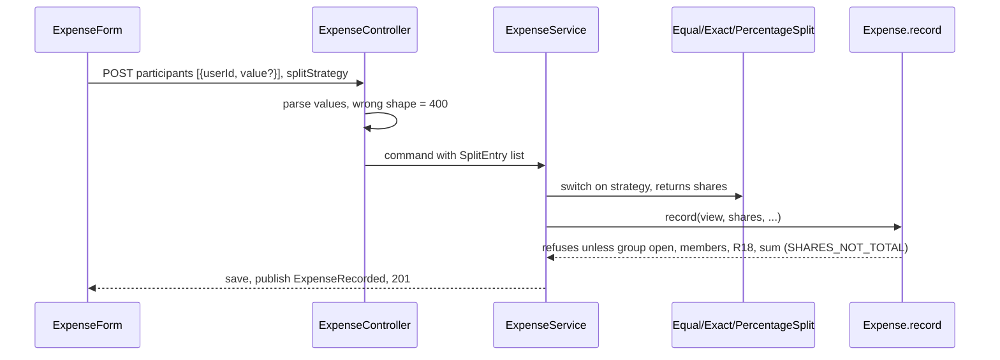

# Review: split strategies (exact and percentage)

Branch `feature/split-strategies`. Before: an expense could only be split equally (`SPLIT_NOT_SUPPORTED` for the other two). Now: a member can split an expense equally, by typed amounts or by percentages, and the shares always add up to the total. New: `ExactSplit`, `PercentageSplit`, `SplitEntry`, the error codes `SHARES_NOT_TOTAL` and `PERCENTAGES_NOT_100`; no table, no module, no event changed.

## Features and where to start

Start at the entry point and follow the path yourself: **controller → service → domain (the rules)**, then the test. Backend paths are under `backend/src/main/java/de/hsh/favs/sharewise/`, frontend under `frontend/src/`.

| Feature | Start at (backend) | Frontend | Test to read |
|---|---|---|---|
| **Record an exact split** (J4b) | `expense/web/ExpenseController.recordExpense` `POST /groups/{id}/expenses` → `ExpenseService.recordExpense` → `ExactSplit.split` → `Expense.record` | `components/ExpenseForm.tsx` (`chooseStrategy`, `submit`) | `ExactSplitTest`, `ExpenseControllerTest.anExactSplitIs201WithTheTypedShares` |
| **Record a percentage split** (J4c, the leftover cent) | same path → `PercentageSplit.split` | `lib/money.ts` `percentToHundredths`, `percentageShares` | `PercentageSplitTest.leftoverCentsGoToTheLargestDroppedFraction`, `money.test.ts` (the twin) |
| **A wrong sum is refused** (R4) | `Expense.record` (last check) → `SHARES_NOT_TOTAL`; `PercentageSplit` → `PERCENTAGES_NOT_100` | `ExpenseForm.submit` shows the message, sends nothing | `ExpenseTest.sharesThatDoNotAddUpToTheTotalAreRefusedWithSharesNotTotal`, `ExpenseControllerTest.exactAmountsThatDoNotAddUpAre422SharesNotTotal` |
| *Touched:* equal split | `ExpenseService` switch → `EqualSplit` (unchanged) | `equalShares` moved to `lib/money.ts` | `MallorcaSliceTest.remainderCentsGoToTheFirstParticipantsAndTheSumStaysZero` |

Entry points: the **controller** (HTTP), and the form (component), which calls the route handler `app/api/groups/[groupId]/expenses/route.ts`, which forwards to the controller. No listener changed: settlement and notification only see the finished `ExpenseShare`s.



## Know these before you read

- **`participants` replaces `participantIds`.** One entry per person with an optional `value`; the old shape could carry two lists that disagree. Only this project calls the API.
- **The sum rule lives once, in `Expense.record`** (a 422, no longer a 500). The split functions check only their own input (value ≤ 0, percentages ≠ 100) and run *before* it, so a hand-made bad request can get that error before "group not open"; the form checks first, so users do not see it.
- **The leftover cent goes to the largest dropped fraction**, ties by list order (R4 reworded), so the person who typed the biggest percentage never pays less. For an equal split the result is unchanged. Java and TypeScript compute it twice; both tests carry the same table.
- **An empty `participants` list is a 400** (`minItems: 1`); `NO_PARTICIPANTS` stays the domain answer (duplicates).
- **A share can round to 0.00** (0.50 at 99 % / 1 %), as an equal split already can (0.02 among 3). Allowed on purpose; the typed percentage is not stored, the shares are the truth.
- **The form** previews euro shares only when the percentages add up to exactly 100; EXACT shows the boxes and `Remaining` only; switching the mode clears the typed values.
- Full reasons: `docs/specs/2026-11-17-split-strategies/design.md` (decisions D1 to D12, failure modes F1 to F11) and `git log`.

## Diff and run

```sh
D="git diff -w --ignore-cr-at-eol"     # hides line-ending noise
$D main...HEAD -- docs/api/openapi.yaml                                  # the contract: a good first read
$D main...HEAD -- backend/src/main/java/de/hsh/favs/sharewise/expense    # the backend rules
$D main...HEAD -- frontend/src/components/ExpenseForm.tsx frontend/src/lib/money.ts
git show 4dfd796 --stat                # the design commit; then ce0a3ee (contract), c26c6e2 (domain)
cd backend && ./mvnw -q verify         # Docker must run
cd frontend && npm test && npm run e2e
```

## Open

- Verified in this session: the pre-push gate (frontend lint, typecheck, tests, build; contract lint; backend `verify`) was green on the merge commit `348faf6`; the last commit `1547733` only changed comments.
- **Not run locally:** `npm run e2e` (the dinner is recorded as an exact split in `e2e/mallorca.spec.ts`); CI runs it on the pull request.
- **Not looked at in a browser:** the form in light and dark mode and at phone width (`04_FRONTEND.md` section 5).
- Pull request not opened yet. Parked: a controller test for the 400/422 boundary of a percentage like `-5` or `999`.
